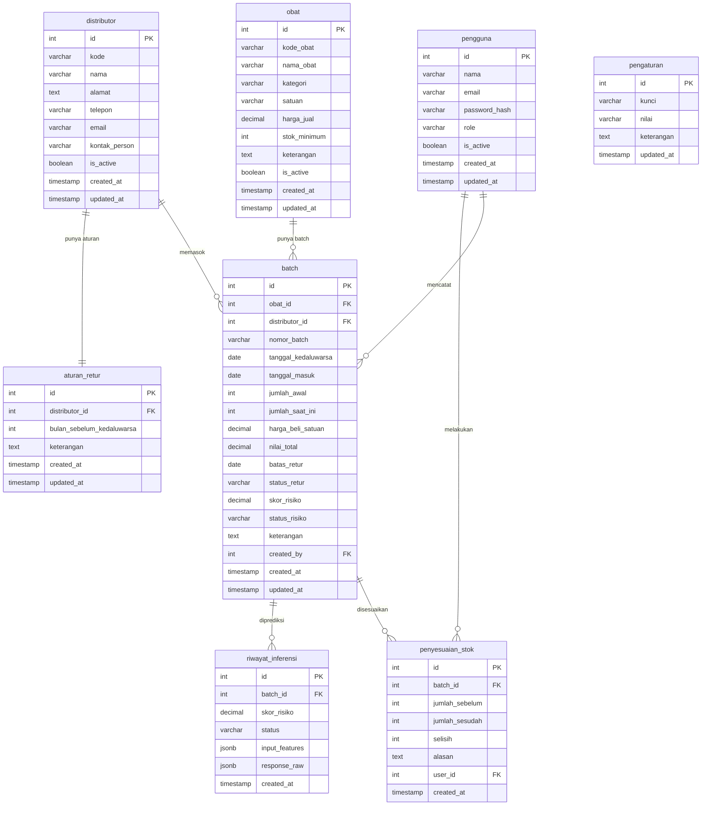

# Desain Database

## Sistem Pemantauan Stok dan Kedaluwarsa — Apotek Asahan Farma

---

| | |
|---|---|
| **Versi Dokumen** | 1.0 |
| **Tanggal Dibuat** | 15 November 2026 |
| **Terakhir Direvisi** | 18 November 2026 |
| **Disusun Oleh** | Charlene Silver, Kendrick Raphael T. |
| **DBMS** | PostgreSQL 15 (Neon Free Tier) |
| **Status** | Draft Final |

### Catatan Revisi

| Versi | Tanggal | Perubahan | Oleh |
|-------|---------|-----------|------|
| 0.1 | 20 Oktober 2026 | Skema awal 5 tabel (users, obat, batch, distributor, penyesuaian) | Charlene |
| 0.2 | 8 November 2026 | Tambah tabel aturan_retur dan riwayat_inferensi | Charlene, Fachri |
| 0.3 | 14 November 2026 | Penyesuaian setelah review use case — hapus tabel penjualan (di luar cakupan) | Tim |
| 1.0 | 18 November 2026 | Finalisasi skema, tambah indeks, seed data | Charlene, Kendrick |

---

## BAB 1: PENDAHULUAN

### 1.1 Tujuan

Dokumen ini mendefinisikan struktur database untuk aplikasi SIMAAF. Skema ini menjadi acuan bagi tim backend saat membuat migration, bagi tim data science saat menyiapkan data awal (seeding), dan bagi tim frontend untuk memahami struktur data yang dikembalikan API.

### 1.2 DBMS dan Koneksi

Kami memakai **PostgreSQL 15** di platform **Neon** (free tier). Alasan memilih Neon: serverless, ada free tier yang cukup untuk prototipe, dan mendukung connection pooling. Koneksi database melalui connection string yang disimpan di environment variable backend (`DATABASE_URL`), tidak pernah di-hardcode di kode maupun repository.

### 1.3 Konvensi Penamaan

- Nama tabel: `snake_case`, bahasa Indonesia, bentuk tunggal (contoh: `obat`, bukan `obats`)
- Nama kolom: `snake_case`
- Primary key: selalu `id` (auto-increment integer atau UUID, tergantung kebutuhan — di sini pakai integer auto-increment karena lebih simpel untuk prototipe)
- Foreign key: `nama_tabel_id` (contoh: `distributor_id` merujuk ke `distributor.id`)
- Timestamp: semua tabel punya `created_at`, sebagian punya `updated_at`
- Boolean: prefix `is_` (contoh: `is_active`)

### 1.4 Catatan Umum

- Tidak pakai soft delete untuk prototipe ini. Jika data dihapus, ya benar-benar dihapus. Ini keputusan sadar karena: (1) data sintetis bisa diisi ulang lewat script, (2) menyederhanakan query. Kalau nanti sistem berkembang, baru pertimbangkan soft delete.
- Semua timestamp dalam timezone UTC, dikonversi di frontend ke WIB (UTC+7).
- `DECIMAL(15,2)` dipakai untuk kolom harga dan nilai. Presisi 15 digit total, 2 desimal. Cukup untuk harga obat di Indonesia.

---

## BAB 2: ENTITY RELATIONSHIP DIAGRAM



Catatan: Diagram di atas menggambarkan relasi utama. Beberapa hal yang perlu diperhatikan:
- Satu distributor punya tepat satu aturan retur (atau tidak punya kalau belum diatur — tapi ini seharusnya diisi admin di awal).
- Satu obat bisa punya banyak batch dari distributor yang berbeda.
- Satu batch bisa punya banyak penyesuaian stok (riwayat).
- Riwayat inferensi mencatat setiap kali model prediksi dipanggil untuk suatu batch.

---

## BAB 3: KAMUS DATA (Data Dictionary)

### 3.1 Tabel `pengguna`

Menyimpan data pengguna yang bisa login ke sistem.

| Kolom | Tipe Data | Nullable | Default | Keterangan |
|-------|-----------|----------|---------|------------|
| id | SERIAL | Tidak | auto | Primary key |
| nama | VARCHAR(100) | Tidak | - | Nama lengkap pengguna |
| email | VARCHAR(150) | Tidak | - | Email untuk login, harus unik |
| password_hash | VARCHAR(255) | Tidak | - | Hash bcrypt dari password |
| role | VARCHAR(20) | Tidak | 'karyawan' | Role pengguna: 'admin' atau 'karyawan' |
| is_active | BOOLEAN | Tidak | true | Apakah akun masih aktif |
| created_at | TIMESTAMPTZ | Tidak | NOW() | Tanggal akun dibuat |
| updated_at | TIMESTAMPTZ | Tidak | NOW() | Terakhir diperbarui |

**Constraints:**
- `PK`: id
- `UNIQUE`: email
- `CHECK`: role IN ('admin', 'karyawan')

**Index:**
- `idx_pengguna_email` pada email (untuk lookup saat login)

Catatan: Role sengaja hanya dua: admin dan karyawan. Dari diskusi dengan Bu Anni, tidak perlu role yang lebih granular karena hanya 4 orang di apotek. Admin itu pemilik/komisaris, karyawan sisanya.

---

### 3.2 Tabel `distributor`

Data pemasok obat ke apotek. Di project plan disebut juga "supplier", tapi kami pakai istilah "distributor" di database karena lebih umum di dunia farmasi Indonesia.

| Kolom | Tipe Data | Nullable | Default | Keterangan |
|-------|-----------|----------|---------|------------|
| id | SERIAL | Tidak | auto | Primary key |
| kode | VARCHAR(20) | Tidak | - | Kode unik distributor (misal: DST-001) |
| nama | VARCHAR(150) | Tidak | - | Nama distributor |
| alamat | TEXT | Ya | NULL | Alamat lengkap |
| telepon | VARCHAR(20) | Ya | NULL | Nomor telepon |
| email | VARCHAR(150) | Ya | NULL | Email kontak |
| kontak_person | VARCHAR(100) | Ya | NULL | Nama PIC di distributor |
| is_active | BOOLEAN | Tidak | true | Apakah masih jadi pemasok aktif |
| created_at | TIMESTAMPTZ | Tidak | NOW() | Tanggal ditambahkan |
| updated_at | TIMESTAMPTZ | Tidak | NOW() | Terakhir diperbarui |

**Constraints:**
- `PK`: id
- `UNIQUE`: kode

**Index:**
- `idx_distributor_kode` pada kode
- `idx_distributor_nama` pada nama (untuk search)

Catatan: Kolom telepon dan email sengaja nullable. Dari data apotek, tidak semua distributor punya info kontak lengkap yang tercatat.

---

### 3.3 Tabel `aturan_retur`

Menyimpan aturan retur per distributor. Setiap distributor punya satu aturan (atau nol jika belum diatur).

| Kolom | Tipe Data | Nullable | Default | Keterangan |
|-------|-----------|----------|---------|------------|
| id | SERIAL | Tidak | auto | Primary key |
| distributor_id | INTEGER | Tidak | - | FK ke distributor |
| bulan_sebelum_kedaluwarsa | INTEGER | Tidak | 6 | Berapa bulan sebelum kedaluwarsa obat masih boleh diretur. 0 berarti distributor tidak menerima retur. |
| keterangan | TEXT | Ya | NULL | Catatan tambahan (misal: "hanya berlaku untuk obat keras") |
| created_at | TIMESTAMPTZ | Tidak | NOW() | Tanggal ditambahkan |
| updated_at | TIMESTAMPTZ | Tidak | NOW() | Terakhir diperbarui |

**Constraints:**
- `PK`: id
- `UNIQUE`: distributor_id (satu distributor satu aturan)
- `FK`: distributor_id → distributor(id) ON DELETE CASCADE
- `CHECK`: bulan_sebelum_kedaluwarsa >= 0

Contoh: Jika bulan_sebelum_kedaluwarsa = 3, dan obat kedaluwarsa 1 Maret 2027, maka batas retur = 1 Desember 2026 (3 bulan sebelumnya). Jika bulan_sebelum_kedaluwarsa = 0, distributor tidak terima retur sama sekali.

Bu Anni menyebut aturan retur yang dia tahu: 1 bulan, 3 bulan, 6 bulan, atau tidak terima retur. Default 6 bulan karena itu yang paling umum menurut beliau.

---

### 3.4 Tabel `obat`

Data master obat. Satu record = satu jenis obat. Stok aktualnya ada di tabel batch.

| Kolom | Tipe Data | Nullable | Default | Keterangan |
|-------|-----------|----------|---------|------------|
| id | SERIAL | Tidak | auto | Primary key |
| kode_obat | VARCHAR(30) | Tidak | - | Kode unik obat (misal: OBT-001) |
| nama_obat | VARCHAR(200) | Tidak | - | Nama obat |
| kategori | VARCHAR(50) | Ya | NULL | Kategori: antibiotik, analgesik, vitamin, dll. Free text, tidak di-normalize karena di data sintetis cukup beragam |
| satuan | VARCHAR(30) | Tidak | - | Satuan jual: tablet, strip, box, botol, tube, sachet |
| harga_jual | DECIMAL(15,2) | Ya | NULL | Harga jual ke konsumen. Nullable karena di prototipe fokusnya ke stok, bukan penjualan |
| stok_minimum | INTEGER | Tidak | 10 | Ambang batas stok menipis. Jika total stok semua batch aktif di bawah ini, muncul pengingat |
| keterangan | TEXT | Ya | NULL | Catatan tambahan |
| is_active | BOOLEAN | Tidak | true | Apakah obat masih aktif dijual |
| created_at | TIMESTAMPTZ | Tidak | NOW() | Tanggal ditambahkan |
| updated_at | TIMESTAMPTZ | Tidak | NOW() | Terakhir diperbarui |

**Constraints:**
- `PK`: id
- `UNIQUE`: kode_obat

**Index:**
- `idx_obat_kode` pada kode_obat
- `idx_obat_nama` pada nama_obat (untuk search)
- `idx_obat_kategori` pada kategori (untuk filter)

Catatan: Kategori sengaja pakai free text (VARCHAR), bukan tabel terpisah. Alasannya: di data sintetis ada ±20-an kategori, dan untuk prototipe tidak perlu maintenance tabel kategori sendiri. Kalau nanti sistem berkembang, baru dipisah.

---

### 3.5 Tabel `batch`

Ini tabel inti dari sistem. Setiap record adalah satu batch obat dengan nomor batch, tanggal kedaluwarsa, dan jumlah stok yang spesifik.

| Kolom | Tipe Data | Nullable | Default | Keterangan |
|-------|-----------|----------|---------|------------|
| id | SERIAL | Tidak | auto | Primary key |
| obat_id | INTEGER | Tidak | - | FK ke obat |
| distributor_id | INTEGER | Tidak | - | FK ke distributor yang memasok batch ini |
| nomor_batch | VARCHAR(50) | Tidak | - | Nomor batch dari pabrik/distributor |
| tanggal_kedaluwarsa | DATE | Tidak | - | Tanggal kedaluwarsa obat |
| tanggal_masuk | DATE | Tidak | - | Tanggal batch diterima di apotek |
| jumlah_awal | INTEGER | Tidak | - | Jumlah saat pertama kali diterima |
| jumlah_saat_ini | INTEGER | Tidak | - | Jumlah stok saat ini (berubah saat penyesuaian) |
| harga_beli_satuan | DECIMAL(15,2) | Tidak | - | Harga beli per satuan |
| nilai_total | DECIMAL(15,2) | Ya | NULL | jumlah_saat_ini × harga_beli_satuan. Dihitung backend saat simpan/update |
| batas_retur | DATE | Ya | NULL | Tanggal terakhir masih bisa retur. Dihitung dari tanggal_kedaluwarsa - aturan distributor |
| status_retur | VARCHAR(30) | Tidak | 'belum_diretur' | Status: 'belum_diretur', 'bisa_diretur', 'lewat_batas', 'sudah_diretur' |
| skor_risiko | DECIMAL(5,4) | Ya | NULL | Skor dari model prediksi (0.0000 - 1.0000). NULL jika belum diprediksi |
| status_risiko | VARCHAR(20) | Ya | NULL | Label risiko: 'rendah', 'sedang', 'tinggi', atau NULL jika belum ada skor |
| keterangan | TEXT | Ya | NULL | Catatan, misalnya "skor belum tersedia" |
| created_by | INTEGER | Ya | NULL | FK ke pengguna yang menginput |
| created_at | TIMESTAMPTZ | Tidak | NOW() | Tanggal batch diinput ke sistem |
| updated_at | TIMESTAMPTZ | Tidak | NOW() | Terakhir diperbarui |

**Constraints:**
- `PK`: id
- `FK`: obat_id → obat(id) ON DELETE RESTRICT
- `FK`: distributor_id → distributor(id) ON DELETE RESTRICT
- `FK`: created_by → pengguna(id) ON DELETE SET NULL
- `CHECK`: jumlah_awal > 0
- `CHECK`: jumlah_saat_ini >= 0
- `CHECK`: harga_beli_satuan >= 0
- `CHECK`: skor_risiko IS NULL OR (skor_risiko >= 0 AND skor_risiko <= 1)

**Index:**
- `idx_batch_obat` pada obat_id
- `idx_batch_distributor` pada distributor_id
- `idx_batch_kedaluwarsa` pada tanggal_kedaluwarsa (paling sering diquery untuk pengingat)
- `idx_batch_batas_retur` pada batas_retur (untuk daftar pengingat retur)
- `idx_batch_status_risiko` pada status_risiko (untuk filter dashboard)

Catatan: Kolom `nilai_total` sebenarnya bisa dihitung dari `jumlah_saat_ini * harga_beli_satuan`, tapi kami simpan sebagai kolom karena sering dipakai di dashboard dan tabel agregasi. Mempercepat query tanpa harus kalkulasi ulang terus.

Kolom `batas_retur` juga dihitung (tanggal_kedaluwarsa minus bulan_sebelum_kedaluwarsa dari aturan_retur), tapi disimpan supaya bisa di-index dan query langsung. Diperbarui tiap kali aturan retur distributor berubah.

---

### 3.6 Tabel `penyesuaian_stok`

Mencatat riwayat setiap kali stok batch disesuaikan dari cek fisik.

| Kolom | Tipe Data | Nullable | Default | Keterangan |
|-------|-----------|----------|---------|------------|
| id | SERIAL | Tidak | auto | Primary key |
| batch_id | INTEGER | Tidak | - | FK ke batch yang disesuaikan |
| jumlah_sebelum | INTEGER | Tidak | - | Stok sebelum penyesuaian |
| jumlah_sesudah | INTEGER | Tidak | - | Stok setelah penyesuaian |
| selisih | INTEGER | Tidak | - | Selisih (sesudah - sebelum). Bisa negatif. |
| alasan | TEXT | Ya | NULL | Alasan penyesuaian (misal: "cek fisik bulanan") |
| user_id | INTEGER | Tidak | - | FK ke pengguna yang melakukan penyesuaian |
| created_at | TIMESTAMPTZ | Tidak | NOW() | Tanggal penyesuaian |

**Constraints:**
- `PK`: id
- `FK`: batch_id → batch(id) ON DELETE CASCADE
- `FK`: user_id → pengguna(id) ON DELETE RESTRICT
- `CHECK`: jumlah_sesudah >= 0

**Index:**
- `idx_penyesuaian_batch` pada batch_id
- `idx_penyesuaian_tanggal` pada created_at (untuk melihat riwayat kronologis)

Catatan: Tabel ini ditambahkan setelah diskusi lebih lanjut dengan Bu Anni soal proses stock opname. Beliau bilang kadang jumlah obat di rak tidak sesuai catatan karena ada yang terselip, pecah, atau salah hitung waktu masuk. Riwayat penyesuaian penting supaya bisa dilacak kapan dan oleh siapa stok diubah.

---

### 3.7 Tabel `riwayat_inferensi`

Mencatat setiap pemanggilan model prediksi risiko untuk suatu batch. Berguna untuk debugging dan audit.

| Kolom | Tipe Data | Nullable | Default | Keterangan |
|-------|-----------|----------|---------|------------|
| id | SERIAL | Tidak | auto | Primary key |
| batch_id | INTEGER | Tidak | - | FK ke batch yang diprediksi |
| skor_risiko | DECIMAL(5,4) | Ya | NULL | Skor yang dikembalikan model |
| status | VARCHAR(20) | Tidak | - | 'sukses', 'gagal', 'timeout' |
| input_features | JSONB | Ya | NULL | Fitur-fitur yang dikirim ke model (untuk reproducibility) |
| response_raw | JSONB | Ya | NULL | Response mentah dari layanan prediksi |
| created_at | TIMESTAMPTZ | Tidak | NOW() | Waktu pemanggilan |

**Constraints:**
- `PK`: id
- `FK`: batch_id → batch(id) ON DELETE CASCADE

**Index:**
- `idx_inferensi_batch` pada batch_id
- `idx_inferensi_tanggal` pada created_at

Catatan: Tabel ini sengaja dibuat karena permintaan Fachri (AI Engineer). Dia bilang penting untuk bisa melacak kapan model dipanggil, input apa yang dikirim, dan apa hasilnya. Terutama berguna kalau ada batch yang skornya terasa "aneh" — bisa dicek inputnya apa.

---

### 3.8 Tabel `pengaturan`

Key-value store sederhana untuk pengaturan sistem.

| Kolom | Tipe Data | Nullable | Default | Keterangan |
|-------|-----------|----------|---------|------------|
| id | SERIAL | Tidak | auto | Primary key |
| kunci | VARCHAR(50) | Tidak | - | Kunci pengaturan (unik) |
| nilai | VARCHAR(255) | Tidak | - | Nilai pengaturan |
| keterangan | TEXT | Ya | NULL | Penjelasan pengaturan ini |
| updated_at | TIMESTAMPTZ | Tidak | NOW() | Terakhir diperbarui |

**Constraints:**
- `PK`: id
- `UNIQUE`: kunci

**Data Awal:**

| kunci | nilai | keterangan |
|-------|-------|------------|
| tanggal_acuan | 2026-10-31 | Tanggal referensi untuk perhitungan pengingat. Diatur admin. |
| stok_minimum_default | 10 | Default ambang stok menipis untuk obat baru |
| batas_kedaluwarsa_warning_hari | 90 | Berapa hari sebelum kedaluwarsa mulai tampil di pengingat |
| batas_retur_warning_hari | 30 | Berapa hari sebelum batas retur mulai tampil di pengingat |

---

## BAB 4: CATATAN TEKNIS

### 4.1 Strategi Indexing

Index dibuat pada kolom yang paling sering di-WHERE, di-JOIN, atau di-ORDER BY. Prioritas utama:
- `batch.tanggal_kedaluwarsa` dan `batch.batas_retur` — ini paling sering diquery untuk pengingat
- `batch.obat_id` dan `batch.distributor_id` — untuk JOIN
- Kolom email dan kode (pengguna, distributor, obat) — untuk lookup

Karena ini prototipe dengan data ±1.400 batch, indexing belum menjadi bottleneck. Tapi kami tetap buat dari awal untuk best practice.

### 4.2 Kalkulasi Kolom Turunan

Dua kolom di tabel batch yang merupakan kalkulasi:
1. `nilai_total` = `jumlah_saat_ini` × `harga_beli_satuan` — diupdate backend saat batch dibuat atau stok disesuaikan
2. `batas_retur` = `tanggal_kedaluwarsa` - `aturan_retur.bulan_sebelum_kedaluwarsa` bulan — dihitung saat batch dibuat, dan diperbarui jika admin mengubah aturan retur distributor

Kenapa disimpan, bukan dihitung on-the-fly? Karena kedua kolom ini sering dipakai di dashboard, tabel agregasi, dan pengurutan. Menyimpannya menghindari sub-query berulang.

### 4.3 Seed Data

Script seeding dijalankan sekali saat setup awal. Data seed meliputi:

1. **Pengguna default:**
   - Admin: email `admin@apotek.local`, password `admin123` (di-hash bcrypt)
   - Karyawan: email `karyawan@apotek.local`, password `karyawan123`

2. **Dataset sintetis** (disiapkan tim Data Science):
   - 14 distributor beserta aturan retur masing-masing
   - 212 obat
   - 1.409 batch
   - Periode November 2025 – Oktober 2026

3. **Pengaturan default** (seperti tabel di bagian 3.8)

Script seeding ditulis dalam JavaScript (dijalankan lewat Node.js), membaca file CSV yang sudah dibersihkan oleh tim DS. Format CSV dan kolom-kolomnya sudah disepakati bersama.

### 4.4 Migration

Migration menggunakan library `node-pg-migrate` atau raw SQL scripts yang dijalankan berurutan. Setiap perubahan skema dicatat sebagai file migration baru, bukan mengedit file lama. Ini supaya jika database online bermasalah, kami bisa buat database baru di Supabase dan jalankan semua migration dari awal.

Urutan migration:
1. `001_create_pengguna.sql`
2. `002_create_distributor.sql`
3. `003_create_aturan_retur.sql`
4. `004_create_obat.sql`
5. `005_create_batch.sql`
6. `006_create_penyesuaian_stok.sql`
7. `007_create_riwayat_inferensi.sql`
8. `008_create_pengaturan.sql`
9. `009_seed_data.sql`

### 4.5 Backup dan Recovery

Untuk prototipe, backup dilakukan dengan cara:
- Dataset sintetis (CSV) disimpan di repository
- Script seeding bisa dijalankan ulang kapan saja
- Jika database Neon bermasalah, tinggal bikin project baru dan jalankan migration + seeding

Ini bukan backup production-grade, tapi cukup untuk konteks prototipe 4 minggu.

---

## LAMPIRAN: SQL DDL

Berikut contoh DDL lengkap untuk referensi (dijalankan lewat migration script):

```sql
-- 001: Tabel pengguna
CREATE TABLE pengguna (
    id SERIAL PRIMARY KEY,
    nama VARCHAR(100) NOT NULL,
    email VARCHAR(150) NOT NULL UNIQUE,
    password_hash VARCHAR(255) NOT NULL,
    role VARCHAR(20) NOT NULL DEFAULT 'karyawan'
        CHECK (role IN ('admin', 'karyawan')),
    is_active BOOLEAN NOT NULL DEFAULT true,
    created_at TIMESTAMPTZ NOT NULL DEFAULT NOW(),
    updated_at TIMESTAMPTZ NOT NULL DEFAULT NOW()
);
CREATE INDEX idx_pengguna_email ON pengguna(email);

-- 002: Tabel distributor
CREATE TABLE distributor (
    id SERIAL PRIMARY KEY,
    kode VARCHAR(20) NOT NULL UNIQUE,
    nama VARCHAR(150) NOT NULL,
    alamat TEXT,
    telepon VARCHAR(20),
    email VARCHAR(150),
    kontak_person VARCHAR(100),
    is_active BOOLEAN NOT NULL DEFAULT true,
    created_at TIMESTAMPTZ NOT NULL DEFAULT NOW(),
    updated_at TIMESTAMPTZ NOT NULL DEFAULT NOW()
);
CREATE INDEX idx_distributor_kode ON distributor(kode);
CREATE INDEX idx_distributor_nama ON distributor(nama);

-- 003: Tabel aturan_retur
CREATE TABLE aturan_retur (
    id SERIAL PRIMARY KEY,
    distributor_id INTEGER NOT NULL UNIQUE
        REFERENCES distributor(id) ON DELETE CASCADE,
    bulan_sebelum_kedaluwarsa INTEGER NOT NULL DEFAULT 6
        CHECK (bulan_sebelum_kedaluwarsa >= 0),
    keterangan TEXT,
    created_at TIMESTAMPTZ NOT NULL DEFAULT NOW(),
    updated_at TIMESTAMPTZ NOT NULL DEFAULT NOW()
);

-- 004: Tabel obat
CREATE TABLE obat (
    id SERIAL PRIMARY KEY,
    kode_obat VARCHAR(30) NOT NULL UNIQUE,
    nama_obat VARCHAR(200) NOT NULL,
    kategori VARCHAR(50),
    satuan VARCHAR(30) NOT NULL,
    harga_jual DECIMAL(15,2),
    stok_minimum INTEGER NOT NULL DEFAULT 10,
    keterangan TEXT,
    is_active BOOLEAN NOT NULL DEFAULT true,
    created_at TIMESTAMPTZ NOT NULL DEFAULT NOW(),
    updated_at TIMESTAMPTZ NOT NULL DEFAULT NOW()
);
CREATE INDEX idx_obat_kode ON obat(kode_obat);
CREATE INDEX idx_obat_nama ON obat(nama_obat);
CREATE INDEX idx_obat_kategori ON obat(kategori);

-- 005: Tabel batch
CREATE TABLE batch (
    id SERIAL PRIMARY KEY,
    obat_id INTEGER NOT NULL
        REFERENCES obat(id) ON DELETE RESTRICT,
    distributor_id INTEGER NOT NULL
        REFERENCES distributor(id) ON DELETE RESTRICT,
    nomor_batch VARCHAR(50) NOT NULL,
    tanggal_kedaluwarsa DATE NOT NULL,
    tanggal_masuk DATE NOT NULL,
    jumlah_awal INTEGER NOT NULL CHECK (jumlah_awal > 0),
    jumlah_saat_ini INTEGER NOT NULL CHECK (jumlah_saat_ini >= 0),
    harga_beli_satuan DECIMAL(15,2) NOT NULL CHECK (harga_beli_satuan >= 0),
    nilai_total DECIMAL(15,2),
    batas_retur DATE,
    status_retur VARCHAR(30) NOT NULL DEFAULT 'belum_diretur',
    skor_risiko DECIMAL(5,4)
        CHECK (skor_risiko IS NULL OR (skor_risiko >= 0 AND skor_risiko <= 1)),
    status_risiko VARCHAR(20),
    keterangan TEXT,
    created_by INTEGER REFERENCES pengguna(id) ON DELETE SET NULL,
    created_at TIMESTAMPTZ NOT NULL DEFAULT NOW(),
    updated_at TIMESTAMPTZ NOT NULL DEFAULT NOW()
);
CREATE INDEX idx_batch_obat ON batch(obat_id);
CREATE INDEX idx_batch_distributor ON batch(distributor_id);
CREATE INDEX idx_batch_kedaluwarsa ON batch(tanggal_kedaluwarsa);
CREATE INDEX idx_batch_batas_retur ON batch(batas_retur);
CREATE INDEX idx_batch_status_risiko ON batch(status_risiko);

-- 006: Tabel penyesuaian_stok
CREATE TABLE penyesuaian_stok (
    id SERIAL PRIMARY KEY,
    batch_id INTEGER NOT NULL
        REFERENCES batch(id) ON DELETE CASCADE,
    jumlah_sebelum INTEGER NOT NULL,
    jumlah_sesudah INTEGER NOT NULL CHECK (jumlah_sesudah >= 0),
    selisih INTEGER NOT NULL,
    alasan TEXT,
    user_id INTEGER NOT NULL
        REFERENCES pengguna(id) ON DELETE RESTRICT,
    created_at TIMESTAMPTZ NOT NULL DEFAULT NOW()
);
CREATE INDEX idx_penyesuaian_batch ON penyesuaian_stok(batch_id);
CREATE INDEX idx_penyesuaian_tanggal ON penyesuaian_stok(created_at);

-- 007: Tabel riwayat_inferensi
CREATE TABLE riwayat_inferensi (
    id SERIAL PRIMARY KEY,
    batch_id INTEGER NOT NULL
        REFERENCES batch(id) ON DELETE CASCADE,
    skor_risiko DECIMAL(5,4),
    status VARCHAR(20) NOT NULL,
    input_features JSONB,
    response_raw JSONB,
    created_at TIMESTAMPTZ NOT NULL DEFAULT NOW()
);
CREATE INDEX idx_inferensi_batch ON riwayat_inferensi(batch_id);
CREATE INDEX idx_inferensi_tanggal ON riwayat_inferensi(created_at);

-- 008: Tabel pengaturan
CREATE TABLE pengaturan (
    id SERIAL PRIMARY KEY,
    kunci VARCHAR(50) NOT NULL UNIQUE,
    nilai VARCHAR(255) NOT NULL,
    keterangan TEXT,
    updated_at TIMESTAMPTZ NOT NULL DEFAULT NOW()
);

-- 009: Seed data pengaturan
INSERT INTO pengaturan (kunci, nilai, keterangan) VALUES
    ('tanggal_acuan', '2026-10-31', 'Tanggal referensi perhitungan pengingat'),
    ('stok_minimum_default', '10', 'Default ambang stok menipis'),
    ('batas_kedaluwarsa_warning_hari', '90', 'Hari sebelum kedaluwarsa mulai tampil pengingat'),
    ('batas_retur_warning_hari', '30', 'Hari sebelum batas retur mulai tampil pengingat');

-- Seed pengguna default
INSERT INTO pengguna (nama, email, password_hash, role) VALUES
    ('Admin Apotek', 'admin@apotek.local', '$2b$10$...', 'admin'),
    ('Karyawan', 'karyawan@apotek.local', '$2b$10$...', 'karyawan');
```

---

*Dokumen ini menjadi acuan saat membuat migration script. Perubahan skema harus melalui file migration baru dan dikomunikasikan ke seluruh tim.*
