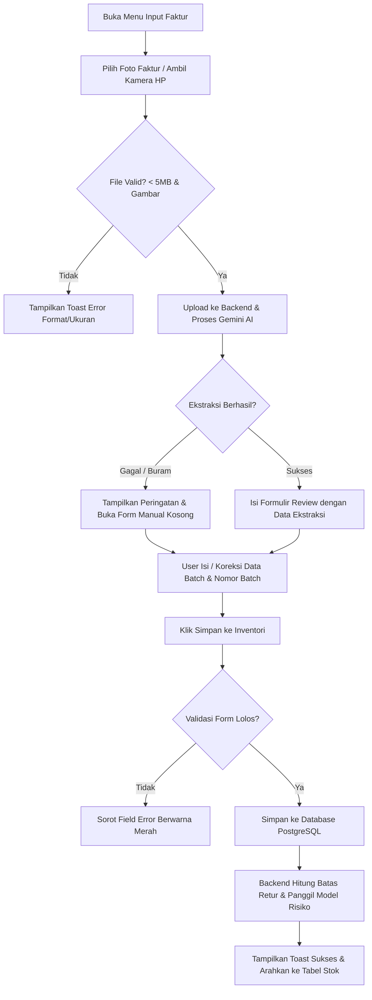
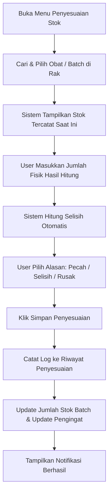

# Spesifikasi Desain UI/UX & Antarmuka Frontend

## Sistem Pemantauan Stok dan Kedaluwarsa — Apotek Asahan Farma

---

| | |
|---|---|
| **Versi Dokumen** | 1.0 |
| **Tanggal Dibuat** | 16 November 2026 |
| **Terakhir Direvisi** | 18 November 2026 |
| **Disusun Oleh** | Nugroho Anjar Abidin, Dio Stania Adinata |
| **Tech Stack Frontend** | React 18, Vite, Tailwind CSS, shadcn/ui, Lucide Icons, Axios |
| **Status** | Panduan Resmi Tim Frontend (A26-CS114) |

### Pengantar & Prinsip Desain

> **Catatan untuk Developer Frontend (Nugroho / Rekan Tim):**
> Target pengguna kita adalah **Bu Anni (Komisaris)** dan **karyawan apotek di Kisaran**. Sebagian besar dari mereka tidak terbiasa dengan istilah IT yang rumit, dan sehari-hari bekerja melayani pembeli di apotek sambil sesekali mengecek layar laptop atau HP.
> 
> Karena itu, prinsip desain kita:
> 1. **Sederhana & Jelas:** Hindari dashboard yang terlalu ramai. Informasi tenggat retur dan obat kedaluwarsa harus langsung terlihat dalam 3 detik pertama.
> 2. **Kontras & Ramah Mata:** Gunakan palet hijau apotek yang menenangkan, dipadu dengan warna status yang tegas: Merah untuk Bahaya/Lewat Batas, Kuning/Amber untuk Waspada/Bisa Diretur, Hijau untuk Aman.
> 3. **Feedback Cepat:** Setiap aksi (upload foto faktur, klik simpan, ubah stok) wajib menampilkan indikator loading, pesan sukses, atau pesan error berbahasa Indonesia yang manusiawi.
> 4. **No "Coming Soon":** Sesuai kriteria Capstone Asah 2026, jangan pasang tombol atau halaman dummy "Segera Hadir". Semua fitur yang tampil harus berfungsi.

---

## BAB 1: DESIGN SYSTEM & DESIGN TOKENS

### 1.1 Palet Warna (Color Palette)

Implementasi menggunakan konfigurasi Tailwind CSS (`tailwind.config.js`):

```js
// Referensi tailwind.config.js
module.exports = {
  theme: {
    extend: {
      colors: {
        brand: {
          50: '#f0fdf4',
          100: '#dcfce7',
          500: '#16a34a', // Hijau apotek utama
          600: '#15803d',
          700: '#166534',
          900: '#14532d',
        },
        status: {
          danger: '#dc2626',      // Merah: Lewat batas retur / Kedaluwarsa / Risiko Tinggi
          dangerBg: '#fef2f2',
          warning: '#d97706',     // Kuning/Amber: Mendekati batas retur / Risiko Sedang
          warningBg: '#fffbeb',
          success: '#16a34a',     // Hijau: Aman / Selesai
          successBg: '#f0fdf4',
          neutral: '#6b7280',     // Abu-abu: Belum ada data / Stok normal
        }
      }
    }
  }
}
```

| Nama Token | Hex Code | Contoh Penggunaan di UI |
|---|---|---|
| `brand-600` | `#15803d` | Navbar header, tombol primer (`Simpan`, `Upload Faktur`) |
| `status-danger` | `#dc2626` | Badge `Lewat Batas Retur`, badge `Risiko Tinggi`, teks error |
| `status-warning` | `#d97706` | Badge `Bisa Diretur Segera`, alert H-30 hari |
| `status-success` | `#16a34a` | Badge `Stok Aman`, notifikasi toast berhasil simpan |
| `surface-ground` | `#f8fafc` | Background utama aplikasi (Slate 50) |
| `surface-card` | `#ffffff` | Background kartu, modal dialog, dan baris tabel |

### 1.2 Tipografi

- **Font Family Utama:** `Inter`, `sans-serif` (Sesuai panduan capstone Dicoding/Asah).
- **Hierarki Font:**
  - `H1` (Judul Halaman): `text-2xl font-bold text-slate-900` (24px)
  - `H2` (Judul Bagian/Kartu): `text-lg font-semibold text-slate-800` (18px)
  - `Body` (Teks Utama/Tabel): `text-sm font-normal text-slate-700` (14px)
  - `Caption` / `Label`: `text-xs font-medium text-slate-500` (12px)
  - `Nominal/Angka Dashboard`: `text-3xl font-extrabold text-slate-900 tracking-tight` (30px)

### 1.3 Spacing & Ukuran Komponen

- Padding container utama: `px-4 py-6 md:px-8 md:py-8`
- Jarak antar section/kartu: `gap-6` (24px)
- Border radius standar: `rounded-lg` (8px) untuk kartu, `rounded-md` (6px) untuk button & input.
- Ketinggian tombol & input field: `h-10` (40px) untuk kemudahan sentuh di HP.

---

## BAB 2: STRUKTUR LAYOUT & NAVIGASI

Aplikasi menggunakan layout **Sidebar Responsif + Top Header**:

```
+-------------------------------------------------------------------------+
| [Logo Apotek] SIMAAF       | Tanggal Acuan: 31 Okt 2026 | [User] Anni ▼ |
+-------------------------------------------------------------------------+
| [≡] SIDEBAR                | CONTENT AREA                               |
|                            |                                            |
| 📊 Dashboard (Admin)       | [Breadcrumb: Home / Input Faktur]          |
| 📥 Input Faktur (AI)       |                                            |
| 📦 Tabel Stok & Batch      | +----------------------------------------+ |
| ⚠️ Pengingat & Retur (18)  | | Card / Form / Tabel                    | |
| ⚖️ Penyesuaian Stok        | |                                        | |
| 📅 Kalender Tenggat        | |                                        | |
| ⚙️ Pengaturan (Admin)      | +----------------------------------------+ |
| 🚪 Keluar                  |                                            |
+-------------------------------------------------------------------------+
```

### 2.1 Komponen Header Atas
- **Kiri:** Logo Apotek Asahan Farma + Akronim SIMAAF.
- **Tengah:** Pill indikator `Tanggal Acuan Sistem: 31 Okt 2026` (Warna amber lembut agar semua pengguna sadar simulasi berbasis tanggal acuan).
- **Kanan:**
  - Icon Lonceng (Badge jumlah pengingat mendesak).
  - Profil Avatar + Nama (`Anni - Komisaris` atau `Karyawan`).
  - Tombol Logout dengan konfirmasi dialog.

### 2.2 Komponen Sidebar
- **Dashboard** (`/dashboard`): Hanya tampil untuk role `admin`.
- **Input Faktur** (`/faktur/input`): Tampil untuk `admin` dan `karyawan`.
- **Tabel Persediaan** (`/inventori`): Tampil untuk semua role.
- **Pengingat & Retur** (`/pengingat`): Tampil untuk semua role dengan pill badge warna merah jika ada retur mendesak.
- **Penyesuaian Stok** (`/stok/penyesuaian`): Tampil untuk semua role.
- **Kalender Tenggat** (`/kalender`): Tampil untuk semua role.
- **Pengaturan** (`/pengaturan`): Hanya tampil untuk role `admin`.

---

## BAB 3: SPESIFIKASI DETAIL HALAMAN APLIKASI

---

### 3.1 Halaman Login (`/login`)

Tampilan minimalis satu kolom di tengah layar (*clean card centered*).

* **Komponen:**
  - Logo Apotek Asahan Farma di bagian atas kartu.
  - Judul: "Sistem Pemantauan Stok & Kedaluwarsa".
  - Subjudul: "Masuk untuk mengelola data inventori apotek".
  - Input `Email`: Placeholder `contoh@apotek.local`, icon Mail.
  - Input `Kata Sandi`: Tipe password dengan tombol intip sandi (Eye icon).
  - Tombol `Masuk ke Aplikasi` (Full width, warna hijau apotek).
  - Footer kartu: "Akun demo: admin@apotek.local / karyawan@apotek.local".
* **Kondisi State:**
  - *Default:* Form bersih siap input.
  - *Loading:* Tombol menampilkan spinner animasi dan teks "Memverifikasi...".
  - *Error:* Alert box merah di atas form: "Email atau kata sandi tidak cocok. Silakan coba lagi."

---

### 3.2 Halaman Input Faktur & Ekstraksi AI (`/faktur/input`)

Ini adalah pintu masuk data utama aplikasi yang menghubungkan frontend dengan kecerdasan buatan (Gemini).

* **Alur Antarmuka:**
  1. **Zona Unggah Berkas (Drag & Drop Zone):**
     - Area bergaris putus-putus (`border-dashed border-2 border-slate-300`).
     - Teks: "Tarik & lepas foto faktur di sini, atau klik untuk memilih file dari galeri / kamera HP".
     - Catatan format: "Format JPG, PNG, atau WEBP. Maksimal 5 MB."
     - Tombol sekunder di kanan bawah: *"Atau Isi Formulir Manual Tanpa Foto"* (Pintu keluar jika foto gagal/buram).
  2. **Indikator Proses Ekstraksi:**
     - Saat file diupload, muncul modal / overlay animasi:
       - Animasi pulsing icon scan dokumen.
       - Teks: "Gemini AI sedang membaca nomor batch, tanggal kedaluwarsa, dan daftar obat..."
       - Progress bar statis lembut (estimasi 5-10 detik).
  3. **Formulir Review & Koreksi Hasil Ekstraksi:**
     - Setelah ekstraksi sukses, layar menampilkan layout 2 kolom:
       - **Kolom Kiri (Desktop) / Tab 1 (HP):** Pratinjau foto faktur (bisa di-zoom/pan untuk mencocokkan angka).
       - **Kolom Kanan (Desktop) / Tab 2 (HP):** Tabel formulir interaktif hasil pembacaan AI.
     - Setiap baris item obat memiliki input:
       - Nama Obat (Dropdown auto-suggest ke master data obat).
       - Nomor Batch (Input text, misal `BMX2610A`).
       - Tanggal Kedaluwarsa (Date picker, min: hari ini).
       - Jumlah Diterima (Input number, min: 1).
       - Harga Beli Satuan (Input rupiah).
       - Tombol Hapus Baris (`Trash` icon) atau Tambah Baris Manual.
  4. **Tombol Tindakan:**
     - Tombol Batal / Upload Ulang.
     - Tombol Primer: `Konfirmasi & Simpan ke Stok` (Hijau).
* **Kondisi Khusus (Fallback):**
  - Jika Gemini gagal membaca (foto miring/buram): Otomatis muncul notifikasi peringatan berwarna kuning: *"Foto tidak terbaca jelas oleh AI. Kami telah menyiapkan formulir manual di bawah ini untuk Anda lengkapi."*

---

### 3.3 Halaman Tabel Persediaan & Agregasi Batch (`/inventori`)

Tabel data komprehensif yang menampilkan semua batch obat yang tersimpan.

* **Filter Bar (Bagian Atas Tabel):**
  - Input pencarian: Search nama obat atau nomor batch.
  - Dropdown Filter Distributor: Pilihan 14 distributor PBF.
  - Dropdown Filter Status Risiko: `Semua`, `Tinggi (Merah)`, `Sedang (Kuning)`, `Rendah (Hijau)`.
  - Dropdown Filter Batas Retur: `Semua`, `Bisa Diretur`, `Lewat Batas`.
  - Date Range: Rentang tanggal kedaluwarsa.
* **Kolom Tabel Persediaan:**
  1. No. Batch & Nama Obat
  2. Distributor
  3. Tanggal Masuk
  4. Tanggal Kedaluwarsa
  5. Batas Retur & Status (Pill Badge)
  6. Sisa Stok (Satuan)
  7. Nilai Persediaan (Rp)
  8. Skor Risiko (Pill Badge AI)
  9. Aksi: Tombol `Detail` & Tombol `Sesuaikan Stok`.
* **Badge Styling:**
  - `Bisa Diretur`: `bg-amber-100 text-amber-800 border-amber-300`
  - `Lewat Batas`: `bg-rose-100 text-rose-800 border-rose-300`
  - `Risiko Tinggi (AI)`: `bg-red-50 text-red-700 font-semibold`
  - `Risiko Rendah`: `bg-emerald-50 text-emerald-700`
* **Pagination:**
  - Baris per halaman: Pilihan 10, 20, 50.
  - Tombol Sebelumnya / Selanjutnya + info `Menampilkan 1-20 dari 1.409 batch`.

---

### 3.4 Halaman Pengingat & Retur Alert (`/pengingat`)

Halaman paling krusial untuk operasional harian apotek guna mencegah kerugian obat hangus.

* **Header Banner Ringkasan:**
  - 3 Kotak Kartu Alert di atas:
    - **Kotak 1 (Merah):** 6 Batch Mendesak Diretur (Tenggat < 30 hari).
    - **Kotak 2 (Kuning):** 8 Batch Mendekati Kedaluwarsa (Tenggat < 90 hari).
    - **Kotak 3 (Biru/Abu):** 4 Obat Stok Menipis (Di bawah ambang minimum).
* **Daftar Kartu Pengingat (Card List View):**
  - Tampilan menggunakan kartu interaktif (bukan sekadar tabel kering) agar mudah dibaca di layar HP karyawan.
  - Setiap kartu menampilkan:
    - Badge Urgensi: `Sisa 15 Hari Lagi untuk Retur ke PBF Enseval`
    - Judul: Nama Obat (Ukuran besar, tebal) & Nomor Batch.
    - Sisa Fisik: `15 box tersisa (Nilai: Rp 630.000)`.
    - Tanggal Penting:
      - Tgl Kedaluwarsa: `15 Jan 2027`
      - Batas Akhir Retur: `15 Nov 2026` (Dihitung dari aturan 2 bulan sebelum exp).
    - Rekomendasi Sistem: *"Segera pisahkan obat dari rak display dan buat form retur fisik ke distributor."*
    - Tombol Tindakan Cepat: `Tandai Telah Diretur` atau `Cek Fisik Rak`.

---

### 3.5 Halaman Penyesuaian Stok / Stock Opname (`/stok/penyesuaian`)

Digunakan karyawan saat melakukan cek fisik obat di rak apotek.

* **Formulir Penyesuaian:**
  1. Pilih Batch Obat: Dropdown dengan live search (menampilkan nama obat, nomor batch, dan lokasi rak).
  2. Card Info Batch Terpilih:
     - Stok Tercatat Sistem: `24 tablet`
     - Harga Beli: `Rp 18.500 / botol`
  3. Fitur Scan Kartu Stok (Opsional - Gemini Vision):
     - Tombol "Foto Kartu Stok Fisik".
     - Preview hasil pembacaan AI: *"Terbaca angka 20 di kartu stok"*.
  4. Input Realita Cek Fisik:
     - Field `Jumlah Stok Fisik Sebenarnya` (Input number, validasi `>= 0`).
     - Tampilan Selisih Otomatis: `Selisih: -4 (Kurang 4 item)` berwarna merah.
  5. Input `Alasan Penyesuaian`:
     - Pilihan cepat (Radio/Chips): `Barang Pecah / Bocor`, `Kemasan Rusak`, `Selisih Hitung`, `Lainnya`.
     - Catatan bebas (Textarea).
  6. Tombol `Simpan Hasil Cek Fisik`.
* **Tabel Riwayat Penyesuaian (Di Bawah Form):**
  - Tabel 5 penyesuaian terakhir: Tanggal, Nama Obat, Petugas, Jumlah Awal, Jumlah Akhir, Selisih, dan Alasan.

---

### 3.6 Halaman Dashboard Eksekutif (`/dashboard`) — *Admin Only*

Halaman khusus untuk Bu Anni (Komisaris) guna memantau nilai aset apotek dan mengawasi potensi kerugian.

* **Baris 1: Metric Cards (Statistik Utama):**
  1. **Total Nilai Persediaan:** `Rp 185.420.000` (Subteks: 342 batch aktif).
  2. **Nilai Stok Berisiko Hangus:** `Rp 14.250.000` (Teks merah tebal, 7.68% dari total aset).
  3. **Batch Berisiko Tinggi:** `28 Batch` (Prediksi model ML tidak habis sebelum batas retur).
  4. **Perlu Tindakan Minggu Ini:** `6 Batch` (Segera proses retur).
* **Baris 2: Grafik & Analisis Distributor:**
  - **Grafik Batang Horisontal:** Nilai persediaan berisiko per distributor (Menampilkan PBF mana yang paling rawan merugikan apotek akibat batas retur ketat).
  - **Donut Chart:** Komposisi status retur (`Aman`, `Mendekati Batas`, `Lewat Batas`).
* **Baris 3: Rekomendasi Khusus Tim Data Science:**
  - Kotak insight berdesain kartu elegan:
    - *"Distributor PBF Bina Farma Medan memiliki aturan retur paling ketat (1 bulan), menyebabkan 62% retur gagal di masa lalu. Disarankan negosiasi ulang kontrak."*
    - *"28 batch obat fast-moving terpantau memiliki stok berlebih dibanding tren konsumsi apotek."*

---

### 3.7 Halaman Pengaturan Sistem (`/pengaturan`) — *Admin Only*

Halaman konfigurasi parameter aplikasi.

* **Bagian 1: Pengaturan Simulasi & Ambang Batas:**
  - Input `Tanggal Acuan Sistem`: Date input (Default: `2026-10-31`). Dilengkapi penjelasan: *"Tanggal ini digunakan sistem sebagai dasar perhitungan pengingat dan simulasi data capstone."*
  - Input `Ambang Stok Menipis Standar`: Angka (Default: 10).
  - Input `Toleransi Peringatan Kedaluwarsa`: Angka hari (Default: 90 hari).
* **Bagian 2: Tabel Aturan Retur Per Distributor:**
  - Tabel berisi 14 distributor farmasi:
    - Nama Distributor
    - Aturan Retur Saat Ini: Dropdown pilihan (`0 Bulan / Tidak Terima`, `1 Bulan`, `2 Bulan`, `3 Bulan`, `6 Bulan`).
    - Keterangan Khusus.
    - Tombol Edit per baris.
  - Banner Info: *"Perubahan aturan retur distributor akan otomatis menghitung ulang batas retur pada seluruh batch obat terkait."*

---

### 3.8 Halaman Kalender Tenggat (`/kalender`) — *Fitur Tambahan*

* **Tampilan Kalender Penuh (Month View):**
  - Tampilan grid kalender bulanan responsif.
  - Setiap tanggal menampilkan dot atau badge acara:
    - Dot Merah: Tanggal batas retur batch obat tertentu.
    - Dot Kuning: Tanggal kedaluwarsa obat.
  - Klik pada tanggal akan memunculkan popover / drawer samping berisi daftar batch yang jatuh tempo di tanggal tersebut.

---

## BAB 4: KOMPONEN REUSABLE (UI COMPONENT LIBRARY)

Untuk mempercepat kerja tim frontend dan menjaga konsistensi, buat komponen modular di folder `src/components/common/`:

1. **`StatusBadge.jsx`**
   - Menerima prop: `type` (`risiko` / `retur`), `value` (`tinggi`, `sedang`, `rendah`, `bisa_diretur`, `lewat_batas`).
   - Me-render pill badge dengan styling dan icon yang sesuai.
2. **`DataTable.jsx`**
   - Komponen tabel pembungkus shadcn UI dengan built-in search, dropdown filter, sorting header, pagination, dan skeleton loading.
3. **`MetricCard.jsx`**
   - Kartu metrik dashboard dengan title, value besar, subtext perubahan, icon ilustrasi, dan badge status.
4. **`ConfirmDialog.jsx`**
   - Modal konfirmasi saat pengguna melakukan aksi kritis (misal: simpan penyesuaian stok atau logout) untuk mencegah salah klik.
5. **`ToastNotification.jsx`**
   - Wrapper library `sonner` atau shadcn toast untuk feedback sukses (hijau) dan gagal (merah).

---

## BAB 5: DIAGRAM ALUR INTERAKSI PENGGUNA (USER FLOW)

### 5.1 Alur Unggah Faktur & Ekstraksi AI



### 5.2 Alur Penyesuaian Stok Cek Fisik



---

*Spesifikasi UI ini menjadi acuan tunggal styling dan perakitan komponen antarmuka bagi tim frontend A26-CS114.*
