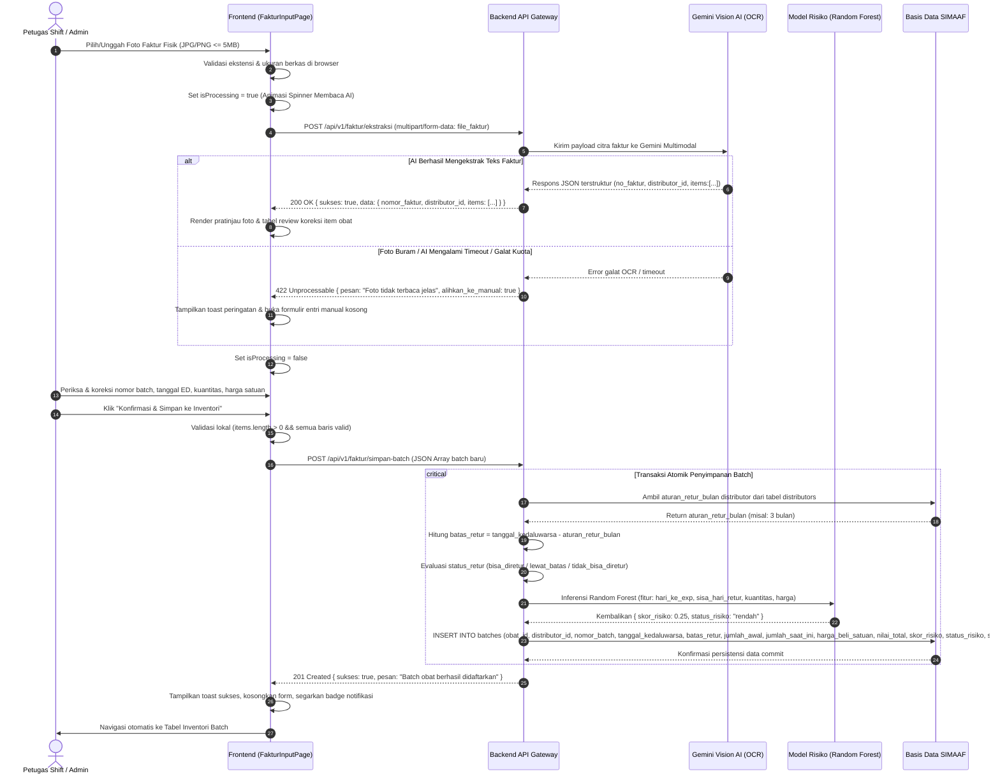
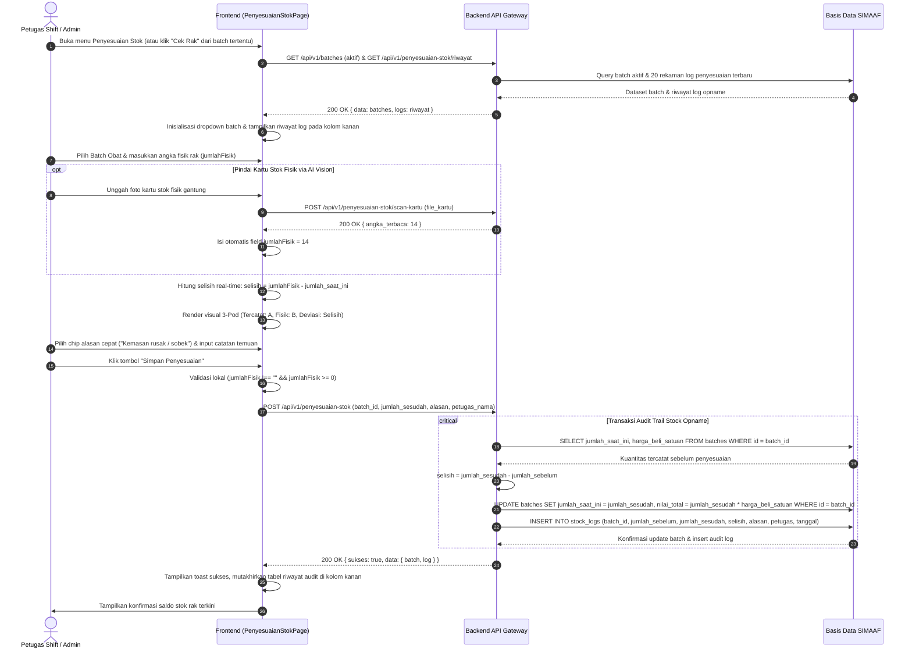
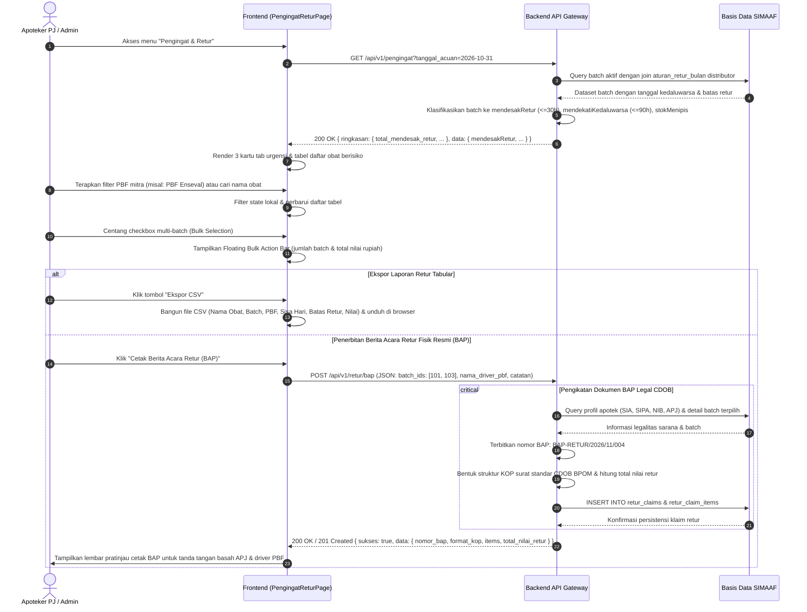
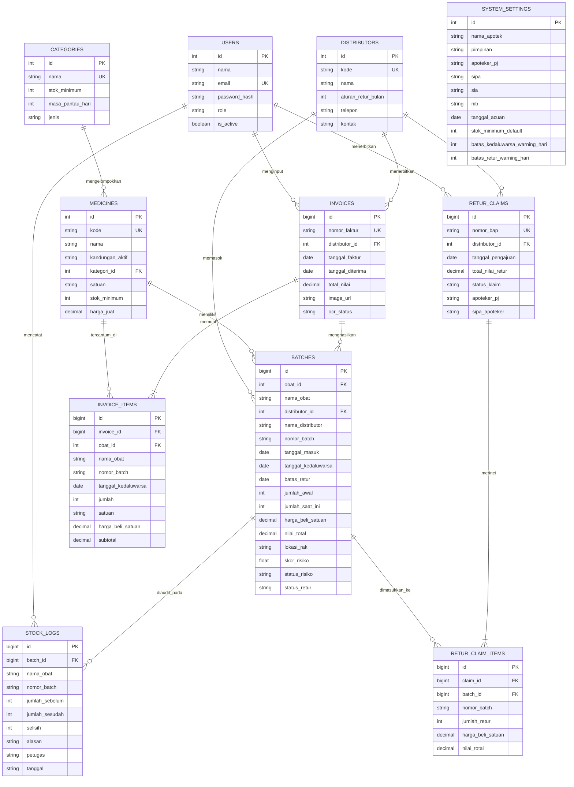

# SPESIFIKASI INTEGRASI BACKEND & KONTRAK ARSITEKTUR SIMAAF
## Sistem Pemantauan Stok dan Kedaluwarsa — Apotek Asahan Farma
**Dokumen Standar Arsitektur, Kontrak REST API, Alur Proses Bisnis, dan Skema Data**

---

### Informasi Dokumen
- **Sistem**: SIMAAF (Sistem Pemantauan Stok dan Kedaluwarsa)
- **Sarana Pelayanan**: Apotek Asahan Farma
- **Alamat**: Jl. Imam Bonjol No. 331, Kel. Kisaran Timur, Kab. Asahan, Sumatera Utara 21214
- **Versi Dokumen**: 1.0.0
- **Status Integrasi**: Produksi & Capstone Asah 2026 Benchmark
- **Basis Referensi Frontend**: React 18 (`frontend/src/services/api.js`, `frontend/src/services/mockData.js`)
- **Prinsip Arsitektur**: **Murni Agnostik Bahasa & Framework** (*Language- & Framework-Agnostic*)

---

## DAFTAR ISI
1. [BAB 1: PRINSIP ARSITEKTUR, KEAMANAN, & MANAJEMEN TANGGAL ACUAN](#bab-1-prinsip-arsitektur-keamanan--manajemen-tanggal-acuan)
   - 1.1 Filosofi Arsitektur Agnostik
   - 1.2 Orkestrasi AI Terkopel Longgar (Decoupled AI Proxy Orchestration)
   - 1.3 Model Keamanan, Sesi JWT, & Hak Akses Berbasis Peran (RBAC)
   - 1.4 Penanganan Tanggal Acuan Tolok Ukur (Benchmark Fixed Reference Date)
   - 1.5 Kepatuhan Regulasi Farmasi: FEFO & CDOB BPOM
   - 1.6 Format Standar Amplop Permintaan & Respons HTTP
2. [BAB 2: KONTRAK SPESIFIKASI REST API LENGKAP](#bab-2-kontrak-spesifikasi-rest-api-lengkap)
   - 2.1 Kategori 1: Autentikasi & Pengelolaan Sesi
   - 2.2 Kategori 2: Ringkasan Dashboard & Telemetri Analitik
   - 2.3 Kategori 3: Manajemen Inventori & Batch Obat
   - 2.4 Kategori 4: Pengingat & Retur Obat
   - 2.5 Kategori 5: Penyesuaian Stok & Audit Fisik Rak (Stock Opname)
   - 2.6 Kategori 6: Penerimaan Faktur & Integrasi AI Vision
   - 2.7 Kategori 7: Kalender Tenggat & Milestones
   - 2.8 Kategori 8: Pengaturan Sistem, Profil Apotek & Master Data
3. [BAB 3: NARASI ALUR KERJA PENGGUNA & DIAGRAM SEKUEN MERMAID](#bab-3-narasi-alur-kerja-pengguna--diagram-sekuen-mermaid)
   - 3.1 Alur 1: Penerimaan Obat via Faktur AI
   - 3.2 Alur 2: Stock Opname Fisik Rak & Pencatatan Audit Trail
   - 3.3 Alur 3: Pengembalian Obat ke PBF Distributor (Retur & BAP Fisik)
4. [BAB 4: KONTRAK SKEMA ENTITAS BASIS DATA & MERMAID ERD](#bab-4-kontrak-skema-entitas-basis-data--mermaid-erd)
   - 4.1 Definisi Tipe Data Agnostik
   - 4.2 Spesifikasi Kolom, Kunci, & Batasan 9 Entitas
   - 4.3 Diagram Relasi Entitas (Mermaid ERD)
   - 4.4 Matriks Integritas Referensial & Kebijakan Cascade
5. [BAB 5: VERIFIKASI KESESUAIAN & PANDUAN PENGUJIAN](#bab-5-verifikasi-kesesuaian--panduan-pengujian)

---

## BAB 1: PRINSIP ARSITEKTUR, KEAMANAN, & MANAJEMEN TANGGAL ACUAN

### 1.1 Filosofi Arsitektur Agnostik
Spesifikasi backend SIMAAF dirancang secara **murni agnostik terhadap bahasa pemrograman, kerangka kerja (framework), maupun runtime eksekusi**. Backend berfungsi sebagai API Gateway, orkestrator aturan bisnis farmasi, serta pelindung integritas transaksional basis data relasional.

Sistem backend dapat diimplementasikan menggunakan tumpukan teknologi apa pun, termasuk namun tidak terbatas pada:
- **Node.js**: Express, Fastify, NestJS
- **Python**: FastAPI, Django REST Framework, Litestar
- **Go**: Gin, Fiber, Echo
- **PHP**: Laravel, Symfony
- **Java / Kotlin**: Spring Boot, Quarkus, Micronaut
- **C#**: .NET 8 / ASP.NET Core Web API
- **Rust**: Actix-web, Axum

Seluruh implementasi wajib mematuhi kontrak protokol HTTP/1.1 atau HTTP/2, skema pertukaran format data JSON (kecuali berkas mutipart dan kalender teks), penamaan atribut berkonvensi `snake_case` (sesuai struktur `mockData.js`), header autentikasi standar, dan aturan validasi farmasi yang didefinisikan pada dokumen ini.

---

### 1.2 Orkestrasi AI Terkopel Longgar (Decoupled AI Proxy Orchestration)
Frontend SIMAAF tidak pernah dan dilarang berkomunikasi langsung dengan penyedia kecerdasan buatan eksternal maupun internal. Seluruh komputasi cerdas diorkestrasi oleh backend sebagai proxy decoupled:

```
[ Frontend React UI ]
         │ (HTTP REST / JSON / Multipart)
         ▼
[ Backend API Gateway / Orchestrator ]
         ├──► [ Database Transaksional (ACID) ]
         ├──► [ Proxy 1: Gemini Multimodal Vision OCR Engine ]
         └──► [ Proxy 2: Machine Learning Risk Inference (Random Forest) ]
```

#### Komponen AI yang Diorkestrasi:
1. **Layanan OCR Vision Multimodal (Faktur & Kartu Stok)**:
   - Digunakan pada `POST /api/v1/faktur/ekstraksi` dan `POST /api/v1/penyesuaian-stok/scan-kartu`.
   - Mengambil citra fisik lembar faktur pengiriman PBF atau kartu stok gantung rak.
   - Melakukan pembacaan teks OCR, ekstraksi entitas terstruktur (Nomor Faktur, PBF, Nama Obat, Nomor Batch, Tanggal Kedaluwarsa, Jumlah Satuan, Harga Perolehan).
   - **Prinsip Graceful Degradation (Pengalihan Manual)**: Jika citra buram, kuota API eksternal terlampaui, atau jaringan AI mengalami timeout, backend wajib mengembalikan kode status terstandar `422 Unprocessable Entity` atau `503 Service Unavailable` dengan payload penanda fallback:
     ```json
     {
       "sukses": false,
       "kode_status": 422,
       "galat": "OCR_EXTRACTION_FAILED",
       "pesan": "Kualitas foto faktur tidak memadai atau sistem AI sedang sibuk. Silakan isi rincian secara manual.",
       "alihkan_ke_manual": true
     }
     ```
     Frontend telah memiliki penanganan siap pakai untuk langsung membuka tabel entri obat kosong tanpa memutus alur kerja petugas apotek.

2. **Layanan Inferensi Risiko Machine Learning (Random Forest Classifier)**:
   - Digunakan saat pendaftaran batch (`POST /api/v1/faktur/simpan-batch`) dan kalkulasi dashboard (`GET /api/v1/dashboard/ringkasan`).
   - Berdasarkan hasil penelitian Capstone Tim Asah 2026, model Random Forest Classifier menghasilkan performa diskriminasi risiko dengan metrik **AUC-ROC 0.91** dan akurasi 88.5%.
   - Fitur-fitur input model:
     - `hari_ke_kedaluwarsa`: Selisih hari antara `tanggal_kedaluwarsa` dan `tanggal_acuan`.
     - `hari_ke_batas_retur`: Selisih hari antara `batas_retur` dan `tanggal_acuan`.
     - `aturan_retur_bulan`: Jendela retur distributor rekanan (0, 1, 2, 3, 6 bulan).
     - `sisa_kuantitas_stok`: Jumlah fisik di rak saat ini.
     - `nilai_total_persediaan`: Nilai finansial terpapar (`jumlah * harga_beli`).
     - `kategori_obat`: Tingkat perputaran obat (*fast-moving* vs *slow-moving*).
   - Klasifikasi Tingkat Risiko:
     - `rendah`: Skor probabilitas `0.00 – 0.39`.
     - `sedang`: Skor probabilitas `0.40 – 0.74`.
     - `tinggi`: Skor probabilitas `0.75 – 1.00`.
   - **Fallback Inferensi**: Jika modul inferensi ML tidak merespons, backend menetapkan `skor_risiko: null` dan `status_risiko: "belum_tersedia"` atau menerapkan aturan heuristik deterministik berbasis sisa hari:
     - Sisa hari retur $\le 30$ hari atau lewat batas $\rightarrow$ `status_risiko: "tinggi"` (skor $0.85$).
     - Sisa hari retur $31 - 60$ hari $\rightarrow$ `status_risiko: "sedang"` (skor $0.55$).
     - Sisa hari retur $> 60$ hari $\rightarrow$ `status_risiko: "rendah"` (skor $0.25$).

---

### 1.3 Model Keamanan, Sesi JWT, & Hak Akses Berbasis Peran (RBAC)
Keamanan aplikasi menerapkan standar stateless JSON Web Token (JWT) yang disematkan pada setiap permintaan melalui header HTTP:
`Authorization: Bearer <jwt_token>`

#### Struktur Token JWT:
- **Header**: Algoritma enkripsi simetris `HS256` (HMAC SHA-256) atau asimetris `RS256`.
- **Payload Claims**:
  - `sub`: Identitas unik pengguna (ID numerik).
  - `nama`: Nama lengkap petugas / komisaris.
  - `email`: Alamat surel terdaftar.
  - `role`: Peran otorisasi pengguna (`admin` atau `karyawan`).
  - `iat`: Stempel waktu penerbitan (Issued At).
  - `exp`: Waktu kedaluwarsa token (misal: 12 jam sejak penerbitan).

#### Matriks Hak Akses Peran Pengguna (Role-Based Access Control):
Sistem membedakan secara tegas dua tingkatan peran pengguna:

| Modul / Operasi Sistem | Endpoint Terkait | Role `admin` (Ibu Anni - Pemilik/Komisaris) | Role `karyawan` (Petugas Shift Apotek) |
|---|---|:---:|:---:|
| Login & Cek Sesi Saja | `/auth/login`, `/auth/me`, `/auth/logout` | Dilayani (Semua) | Dilayani (Semua) |
| Ringkasan Valuasi Eksekutif | `GET /dashboard/ringkasan` | Dilayani Penuh | Ditolak (`403 Forbidden`) |
| Analisis Data Science & PBF | `GET /dashboard/analisis-ds` | Dilayani Penuh | Dilayani (Read-Only) |
| Katalog & Pencarian Batch | `GET /batches`, `GET /batches/{id}` | Dilayani Penuh | Dilayani Penuh |
| Peringatan Retur & Stok Menipis | `GET /pengingat` | Dilayani Penuh | Dilayani Penuh |
| Cetak BAP Retur Fisik | `POST /retur/bap` | Dilayani Penuh | Dilayani Penuh |
| Stock Opname & Audit Rak | `POST /penyesuaian-stok`, `/riwayat` | Dilayani Penuh | Dilayani Penuh |
| Pindai OCR Kartu Stok | `POST /penyesuaian-stok/scan-kartu` | Dilayani Penuh | Dilayani Penuh |
| Ekstraksi Faktur AI & Ingesti | `POST /faktur/ekstraksi`, `/simpan-batch`| Dilayani Penuh | Dilayani Penuh |
| Kalender Tenggat & Ekspor .ics | `GET /kalender/milestones`, `/export.ics`| Dilayani Penuh | Dilayani Penuh |
| Lihat Profil & Matriks 14 PBF | `GET /pengaturan`, `GET /distributor` | Dilayani Penuh | Dilayani (Read-Only) |
| Ubah Konfigurasi Sistem | `PUT /pengaturan` | Dilayani Penuh | Ditolak (`403 Forbidden`) |
| Ubah Aturan Klausul Retur PBF | `PUT /pengaturan/aturan-retur/{id}` | Dilayani Penuh | Ditolak (`403 Forbidden`) |
| Manajemen Profil & Legalitas | `PUT /pengaturan/profil-apotek` | Dilayani Penuh | Ditolak (`403 Forbidden`) |
| Pencadangan & Pemulihan Sistem| `POST /pengaturan/backup`, `/restore` | Dilayani Penuh | Ditolak (`403 Forbidden`) |

---

### 1.4 Penanganan Tanggal Acuan Tolok Ukur (Benchmark Fixed Reference Date)
SIMAAF dikembangkan untuk memenuhi kebutuhan operasional harian Apotek Asahan Farma sekaligus berfungsi sebagai proyek tolok ukur (benchmark) Capstone Asah 2026.

1. **Konfigurasi `tanggal_acuan`**:
   - Sistem menyimpan variabel `tanggal_acuan` pada tabel konfigurasi (`system_settings.tanggal_acuan`), dengan nilai acuan evaluasi baku: `'2026-10-31'`.
   - Seluruh endpoint analitik, batch, pengingat, dan kalender menerima query parameter opsional `?tanggal_acuan=YYYY-MM-DD`.
   - Jika query parameter tidak diberikan, backend mengambil nilai `tanggal_acuan` dari database konfigurasi sistem.
   - Untuk lingkungan operasional masa depan di mana mode simulasi dimatikan, backend dapat beralih menggunakan tanggal kalender server aktual (`CURRENT_DATE`).

2. **Formulasi Matematika Penentuan Batas Retur & Selisih Hari**:
   - **Batas Retur (`batas_retur`)**:
     $$\text{batas\_retur} = \text{tanggal\_kedaluwarsa} - (\text{aturan\_retur\_bulan} \times \text{1 bulan})$$
     *Aturan Khusus*: Jika distributor memiliki `aturan_retur_bulan = 0` (misal PBF Sinar Harapan Farma), maka $\text{batas\_retur} = \text{NULL}$, dan `status_retur` ditetapkan secara permanen sebagai `'tidak_bisa_diretur'`.
   - **Sisa Hari Retur (`sisa_hari_retur`)**:
     $$\text{sisa\_hari\_retur} = \left\lceil \frac{\text{batas\_retur} - \text{tanggal\_acuan}}{86.400.000\text{ ms}} \right\rceil$$
   - **Sisa Hari Kedaluwarsa (`sisa_hari_exp`)**:
     $$\text{sisa\_hari\_exp} = \left\lceil \frac{\text{tanggal\_kedaluwarsa} - \text{tanggal\_acuan}}{86.400.000\text{ ms}} \right\rceil$$
   - **Evaluasi Status Retur (`status_retur`)**:
     - Jika $\text{batas\_retur} \text{ IS NULL} \rightarrow \text{'tidak\_bisa\_diretur'}$
     - Jika $\text{sisa\_hari\_retur} < 0 \rightarrow \text{'lewat\_batas'}$
     - Jika $\text{sisa\_hari\_retur} \ge 0 \rightarrow \text{'bisa\_diretur'}$

---

### 1.5 Kepatuhan Regulasi Farmasi: FEFO & CDOB BPOM
Backend SIMAAF menegakkan kepatuhan terhadap standar **Cara Distribusi Obat yang Baik (CDOB)** yang diatur oleh Badan Pengawas Obat dan Makanan (BPOM) Republik Indonesia:

1. **Prinsip FEFO (First Expired, First Out)**:
   - Sediaan obat dengan masa kedaluwarsa paling dekat wajib dikeluarkan atau diretur terlebih dahulu.
   - Endpoint `GET /api/v1/batches` secara default mengurutkan data berdasarkan kriteria FEFO: `ORDER BY tanggal_kedaluwarsa ASC, batas_retur ASC`.
2. **Berita Acara Pengembalian Barang Retur (BAP-RETUR)**:
   - Pengeluaran fisik sediaan obat mendekati kedaluwarsa dari rak etalase menuju distributor PBF wajib disertai dokumen Berita Acara resmi berkekuatan hukum.
   - Nomor surat penomoran otomatis berstandar: `BAP-RETUR/{YYYY}/{MM}/{INDEX}` (contoh: `BAP-RETUR/2026/11/004`).
   - Dokumen BAP mencantumkan identitas lengkap sarana apotek: Nomor Surat Izin Apotek (SIA), Surat Izin Praktik Apoteker (SIPA) Apoteker Penanggung Jawab (APJ: apt. Nurul Hasanah, S.Farm), Nomor Induk Berusaha (NIB), serta tanda tangan serah terima fisik dengan driver logistik PBF.
3. **Pencatatan Audit Trail Transaksional (Buku Cek Fisik)**:
   - Setiap mutasi pengurangan atau penambahan kuantitas pada stock opname tidak boleh langsung menimpa data tanpa jejak.
   - Wajib mencatat identitas pemeriksa, tanggal waktu pemeriksaan, kuantitas tercatat sistem sebelum opname, hitungan fisik aktual rak, selisih deviasi, dan alasan temuan pada tabel log riwayat penyesuaian.

---

### 1.6 Format Standar Amplop Permintaan & Respons HTTP
Untuk memastikan komunikasi data konsisten antara backend dan antarmuka React:

#### 1. Amplop Standar Respons Sukses (`2xx`):
```json
{
  "sukses": true,
  "pesan": "Operasi berhasil dilaksanakan",
  "tanggal_acuan": "2026-10-31",
  "data": {},
  "meta": {
    "total_data": 342,
    "halaman": 1,
    "limit": 50,
    "total_halaman": 7
  }
}
```

#### 2. Amplop Standar Respons Galat (`4xx` / `5xx`):
```json
{
  "sukses": false,
  "kode_status": 400,
  "galat": "BAD_REQUEST",
  "pesan": "Terjadi kesalahan validasi pada data yang dikirimkan.",
  "detail": [
    {
      "kolom": "nomor_batch",
      "pesan": "Nomor batch wajib diisi dan tidak boleh kosong."
    }
  ]
}
```

#### Daftar Kode Status HTTP yang Digunakan:
- `200 OK`: Permintaan berhasil dan data dikembalikan.
- `201 Created`: Entitas baru (batch obat, log opname, faktur) berhasil dibuat.
- `400 Bad Request`: Parameter query atau payload JSON tidak memenuhi format.
- `401 Unauthorized`: Token JWT tidak disertakan, kedaluwarsa, atau tidak valid.
- `403 Forbidden`: Hak akses peran pengguna tidak mencukupi (misal: Karyawan mengakses data valuasi dashboard).
- `404 Not Found`: Sumber daya (batch ID, distributor ID) tidak ditemukan di database.
- `413 Payload Too Large`: Ukuran berkas foto faktur melebihi batas 5 MB.
- `422 Unprocessable Entity`: Data valid secara sintaksis namun gagal validasi bisnis (misal: stok opname negatif, gambar OCR tak terbaca).
- `500 Internal Server Error`: Kesalahan tak terduga pada server backend atau kegagalan query database.
- `503 Service Unavailable`: Layanan mikrosains AI Vision atau inferensi risiko sedang tidak dapat dihubungi.

---

## BAB 2: KONTRAK SPESIFIKASI REST API LENGKAP

### Kategori 1: Autentikasi & Pengelolaan Sesi

#### 1.1 `POST /api/v1/auth/login`
- **Deskripsi Bisnis**: Memverifikasi kredensial surel dan kata sandi petugas apotek, memeriksa status keaktifan akun, dan menerbitkan token JWT sesi.
- **Header Permintaan**: `Content-Type: application/json`, `Accept: application/json`
- **Skema Request Body**:
  ```json
  {
    "email": "admin@apotek.local",
    "password": "Password123!"
  }
  ```
- **Skema Respons Sukses (`200 OK`)**:
  ```json
  {
    "sukses": true,
    "pesan": "Login berhasil",
    "data": {
      "token": "eyJhbGciOiJIUzI1NiIsInR5cCI6IkpXVCJ9.eyJzdWIiOjEsIm5hbWEiOiJJYnUgQW5uaSAoS29taXNhcmlzKSIsInJvbGUiOiJhZG1pbiJ9...",
      "pengguna": {
        "id": 1,
        "nama": "Ibu Anni (Komisaris)",
        "email": "admin@apotek.local",
        "role": "admin"
      }
    }
  }
  ```
- **Respons Galat**:
  - `400 Bad Request`: Surel atau kata sandi tidak diisi.
  - `401 Unauthorized`: Surel tidak terdaftar atau kata sandi salah.

#### 1.2 `GET /api/v1/auth/me`
- **Deskripsi Bisnis**: Memvalidasi token bearer aktif dari header dan mengembalikan profil pengguna yang sedang login.
- **Header Permintaan**: `Authorization: Bearer <token>`, `Accept: application/json`
- **Skema Respons Sukses (`200 OK`)**:
  ```json
  {
    "sukses": true,
    "pesan": "Profil pengguna sesi aktif berhasil dimuat",
    "data": {
      "id": 1,
      "nama": "Ibu Anni (Komisaris)",
      "email": "admin@apotek.local",
      "role": "admin"
    }
  }
  ```
- **Respons Galat**: `401 Unauthorized` jika token tidak valid, kedaluwarsa, atau tidak disertakan.

#### 1.3 `POST /api/v1/auth/logout`
- **Deskripsi Bisnis**: Mencabut token sesi aktif dan mencatat aktivitas logout pada log keamanan sistem.
- **Header Permintaan**: `Authorization: Bearer <token>`
- **Skema Respons Sukses (`200 OK`)**:
  ```json
  {
    "sukses": true,
    "pesan": "Logout berhasil"
  }
  ```

---

### Kategori 2: Ringkasan Dashboard & Telemetri Analitik

#### 2.1 `GET /api/v1/dashboard/ringkasan`
- **Deskripsi Bisnis**: Menyajikan agregasi metrik eksekutif tingkat tinggi bagi pemilik apotek (Ibu Anni): valuasi persediaan, potensi kerugian retur, rasio kepatuhan FEFO, evaluasi performa model Machine Learning Capstone Asah 2026, dan peringkat risiko 14 PBF.
- **Otorisasi**: Wajib peran `admin` (Ditolak dengan `403 Forbidden` jika diakses oleh `karyawan`).
- **Header Permintaan**: `Authorization: Bearer <token>`
- **Parameter Query**: `tanggal_acuan` (opsional, string tanggal format `YYYY-MM-DD`, default: `'2026-10-31'`).
- **Skema Respons Sukses (`200 OK`)**:
  ```json
  {
    "sukses": true,
    "pesan": "Ringkasan metrik dashboard berhasil dikalkulasi",
    "data": {
      "tanggal_acuan": "2026-10-31",
      "total_nilai_persediaan": 5614500.0,
      "total_batch_aktif": 8,
      "jumlah_batch_berisiko": 4,
      "total_nilai_berisiko": 2315000.0,
      "persentase_berisiko": 41.2,
      "kepatuhan_fefo_persen": 87.5,
      "model_ai_telemetri": {
        "nama_model": "Random Forest Classifier",
        "auc_score": 0.91,
        "akurasi": 0.885,
        "status_evaluasi": "Optimal - Terverifikasi Capstone Asah 2026"
      },
      "distributor_terancam": [
        {
          "nama": "PBF Enseval Putera Megatrading",
          "nilai": 1092000.0,
          "batch_count": 1,
          "aturan_retur_bulan": 3
        },
        {
          "nama": "PBF Bina Farma Medan",
          "nilai": 924000.0,
          "batch_count": 1,
          "aturan_retur_bulan": 1
        },
        {
          "nama": "PBF Sinar Harapan Farma",
          "nilai": 224000.0,
          "batch_count": 1,
          "aturan_retur_bulan": 0
        },
        {
          "nama": "PBF Antar Mitra Sembada (AMS)",
          "nilai": 75000.0,
          "batch_count": 1,
          "aturan_retur_bulan": 2
        }
      ]
    }
  }
  ```

#### 2.2 `GET /api/v1/dashboard/analisis-ds`
- **Deskripsi Bisnis**: Menyajikan temuan kualitatif model Data Science dan rekomendasi tindakan optimasi persediaan bagi pengambil keputusan apotek.
- **Header Permintaan**: `Authorization: Bearer <token>`
- **Skema Respons Sukses (`200 OK`)**:
  ```json
  {
    "sukses": true,
    "pesan": "Analisis kualitatif data science berhasil dimuat",
    "data": {
      "temuan_ds": [
        "Distributor dengan aturan retur singkat (1 bulan) menyumbang 62% obat yang gagal diretur.",
        "Obat antibiotik dan sirup anak memerlukan pemantauan ketat menjelang pergantian bulan.",
        "Semua estimasi risiko dihitung otomatis menggunakan model klasifikasi tim Asah 2026 (AUC 0.91)."
      ],
      "rekomendasi_tindakan": [
        "Negosiasi perpanjangan klausul retur PBF Bina Farma dari 1 bulan menjadi minimal 3 bulan.",
        "Prioritaskan penggunaan fitur OCR Faktur AI untuk percepatan entri dalam 24 jam barang diterima.",
        "Lakukan bundling resep untuk sediaan slow-moving dengan skor risiko di atas 0.80."
      ]
    }
  }
  ```

---

### Kategori 3: Manajemen Inventori & Batch Obat

#### 3.1 `GET /api/v1/batches`
- **Deskripsi Bisnis**: Mengambil daftar inventori seluruh batch obat aktif di rak apotek dengan dukungan pencarian teks, pemfilteran multi-dimensi, pagination, dan pengurutan berbasis kepatuhan FEFO.
- **Header Permintaan**: `Authorization: Bearer <token>`
- **Parameter Query**:
  - `page`: integer (default: `1`)
  - `limit`: integer (default: `50`)
  - `search`: string (pencarian nama obat atau nomor batch)
  - `distributor_id`: integer (filter PBF tertentu)
  - `status_risiko`: string (`semua` | `rendah` | `sedang` | `tinggi`)
  - `status_retur`: string (`semua` | `bisa_diretur` | `lewat_batas` | `tidak_bisa_diretur`)
  - `sort_by`: string (`tanggal_kedaluwarsa` [default FEFO] | `batas_retur` | `skor_risiko` | `nilai_total` | `nama_obat`)
  - `order`: string (`asc` | `desc`, default: `asc`)
  - `tanggal_acuan`: string (format `YYYY-MM-DD`, default: `'2026-10-31'`)
- **Skema Respons Sukses (`200 OK`)**:
  ```json
  {
    "sukses": true,
    "pesan": "Daftar batch inventori berhasil dimuat",
    "tanggal_acuan": "2026-10-31",
    "data": [
      {
        "id": 101,
        "obat_id": 3,
        "nama_obat": "Cefixime 100mg Kapsul",
        "distributor_id": 4,
        "nama_distributor": "PBF Enseval Putera Megatrading",
        "nomor_batch": "CFX-2601-A",
        "tanggal_masuk": "2026-01-15",
        "tanggal_kedaluwarsa": "2027-02-15",
        "batas_retur": "2026-11-15",
        "jumlah_awal": 40,
        "jumlah_saat_ini": 14,
        "harga_beli_satuan": 78000,
        "nilai_total": 1092000,
        "lokasi_rak": "Rak Antibiotik Lt. 1",
        "skor_risiko": 0.88,
        "status_risiko": "tinggi",
        "status_retur": "bisa_diretur",
        "keterangan": "Tenggat retur tinggal 15 hari dari tanggal acuan"
      }
    ],
    "meta": {
      "total_data": 8,
      "halaman": 1,
      "limit": 50,
      "total_halaman": 1
    }
  }
  ```

#### 3.2 `GET /api/v1/batches/{id}`
- **Deskripsi Bisnis**: Mengambil detail profil batch obat tertentu beserta riwayat audit penyesuaian fisik (stock opname) yang pernah dilakukan pada batch tersebut.
- **Header Permintaan**: `Authorization: Bearer <token>`
- **Parameter Jalur (Path Parameter)**: `id` (integer PK unik batch).
- **Skema Respons Sukses (`200 OK`)**:
  ```json
  {
    "sukses": true,
    "pesan": "Detail batch berhasil dimuat",
    "data": {
      "id": 101,
      "nomor_batch": "CFX-2601-A",
      "obat_id": 3,
      "nama_obat": "Cefixime 100mg Kapsul",
      "distributor_id": 4,
      "nama_distributor": "PBF Enseval Putera Megatrading",
      "tanggal_masuk": "2026-01-15",
      "tanggal_kedaluwarsa": "2027-02-15",
      "batas_retur": "2026-11-15",
      "jumlah_awal": 40,
      "jumlah_saat_ini": 14,
      "harga_beli_satuan": 78000,
      "nilai_total": 1092000,
      "lokasi_rak": "Rak Antibiotik Lt. 1",
      "skor_risiko": 0.88,
      "status_risiko": "tinggi",
      "status_retur": "bisa_diretur",
      "keterangan": "Tenggat retur tinggal 15 hari dari tanggal acuan",
      "riwayat_opname": [
        {
          "id": 1,
          "tanggal": "2026-10-28 09:30",
          "jumlah_sebelum": 16,
          "jumlah_sesudah": 14,
          "selisih": -2,
          "alasan": "Pemeriksaan rutin rak antibiotik, 2 strip kemasan sobek/rusak",
          "petugas": "Karyawan Shift Apotek"
        }
      ]
    }
  }
  ```
- **Respons Galat**: `404 Not Found` jika ID batch tidak ditemukan.

---

### Kategori 4: Pengingat & Retur Obat

#### 4.1 `GET /api/v1/pengingat`
- **Deskripsi Bisnis**: Menyajikan pemantauan terpusat 3 kategori intervensi kritis:
  1. `mendesakRetur`: Sisa hari menuju batas retur PBF $\le 30$ hari (urgensi: `kritis` jika $\le 15$ hari, `waspada` jika $16-30$ hari).
  2. `mendekatiKedaluwarsa`: Sisa hari kedaluwarsa $\le 90$ hari (urgensi: `kritis` jika $\le 30$ hari, `waspada` jika $31-90$ hari).
  3. `stokMenipis`: Kuantitas sisa stok fisik di bawah ambang batas safety stock (`jumlah_saat_ini <= stok_minimum`).
- **Header Permintaan**: `Authorization: Bearer <token>`
- **Parameter Query**: `tanggal_acuan` (opsional, format `YYYY-MM-DD`, default: `'2026-10-31'`).
- **Skema Respons Sukses (`200 OK`)**:
  ```json
  {
    "sukses": true,
    "tanggal_acuan": "2026-10-31",
    "ringkasan": {
      "total_mendesak_retur": 2,
      "total_mendekati_kedaluwarsa": 2,
      "total_stok_menipis": 1
    },
    "data": {
      "mendesakRetur": [
        {
          "id": 101,
          "nama_obat": "Cefixime 100mg Kapsul",
          "nomor_batch": "CFX-2601-A",
          "nama_distributor": "PBF Enseval Putera Megatrading",
          "tanggal_kedaluwarsa": "2027-02-15",
          "batas_retur": "2026-11-15",
          "jumlah_saat_ini": 14,
          "nilai_total": 1092000,
          "sisa_hari_retur": 15,
          "urgensi": "kritis",
          "status_retur": "bisa_diretur",
          "skor_risiko": 0.88
        },
        {
          "id": 103,
          "nama_obat": "Amoxicillin 500mg",
          "nomor_batch": "AMX-2604-B",
          "nama_distributor": "PBF Bina Farma Medan",
          "tanggal_kedaluwarsa": "2026-12-05",
          "batas_retur": "2026-11-05",
          "jumlah_saat_ini": 22,
          "nilai_total": 924000,
          "sisa_hari_retur": 5,
          "urgensi": "kritis",
          "status_retur": "bisa_diretur",
          "skor_risiko": 0.82
        }
      ],
      "mendekatiKedaluwarsa": [
        {
          "id": 102,
          "nama_obat": "Salep Mata Kloramfenikol 1%",
          "nomor_batch": "KLM-2509-X",
          "nama_distributor": "PBF Antar Mitra Sembada (AMS)",
          "tanggal_kedaluwarsa": "2026-11-20",
          "batas_retur": "2026-09-20",
          "jumlah_saat_ini": 6,
          "nilai_total": 75000,
          "sisa_hari_exp": 20,
          "urgensi": "kritis",
          "status_retur": "lewat_batas",
          "skor_risiko": 0.96
        }
      ],
      "stokMenipis": [
        {
          "id": 108,
          "nama_obat": "Metformin 500mg Tablet",
          "nomor_batch": "MTF-2512-H",
          "nama_distributor": "PBF Sinar Harapan Farma",
          "jumlah_saat_ini": 8,
          "stok_minimum": 30,
          "status_risiko": "tinggi"
        }
      ]
    }
  }
  ```

#### 4.2 `POST /api/v1/retur/bap`
- **Deskripsi Bisnis**: Penerbitan lembar resmi Berita Acara Penerimaan/Pengembalian Barang Retur (BAP-RETUR) untuk batch-batch obat terpilih (Bulk Retur Action), mengaitkan profil legalitas sarana apotek, dan menyiapkan mutasi pengeluaran barang.
- **Header Permintaan**: `Authorization: Bearer <token>`, `Content-Type: application/json`
- **Skema Request Body**:
  ```json
  {
    "batch_ids": [101, 103],
    "nama_driver_pbf": "Budi Santoso",
    "catatan_tambahan": "Pengembalian batch kritis mendekati batas retur H-15 dan H-5 kalender."
  }
  ```
- **Skema Respons Sukses (`200 OK` / `201 Created`)**:
  ```json
  {
    "sukses": true,
    "pesan": "Berita Acara Retur Fisik resmi berhasil diterbitkan",
    "data": {
      "nomor_bap": "BAP-RETUR/2026/11/004",
      "tanggal_bap": "2026-10-31",
      "total_item": 2,
      "total_nilai_retur": 2016000,
      "format_kop": {
        "nama_apotek": "Apotek Asahan Farma",
        "alamat": "Jl. Imam Bonjol No. 331, Kel. Kisaran Timur, Kab. Asahan, Sumatera Utara 21214",
        "sia": "503/SIA/042/DPMPTSP/2021",
        "sipa": "19930412/SIPA_1208/2022/2041",
        "nib": "1210210063257",
        "apj": "apt. Nurul Hasanah, S.Farm"
      },
      "klausul": "Obat yang diretur wajib bersegel utuh dan diverifikasi nomor batch resminya sesuai ketentuan CDOB BPOM.",
      "items": [
        {
          "batch_id": 101,
          "nama_obat": "Cefixime 100mg Kapsul",
          "nomor_batch": "CFX-2601-A",
          "jumlah_retur": 14,
          "harga_beli_satuan": 78000,
          "subtotal": 1092000
        },
        {
          "batch_id": 103,
          "nama_obat": "Amoxicillin 500mg",
          "nomor_batch": "AMX-2604-B",
          "jumlah_retur": 22,
          "harga_beli_satuan": 42000,
          "subtotal": 924000
        }
      ]
    }
  }
  ```
- **Respons Galat**:
  - `400 Bad Request`: Array `batch_ids` kosong atau tidak valid.
  - `404 Not Found`: Salah satu batch ID tidak ditemukan di inventori.

---

### Kategori 5: Penyesuaian Stok & Audit Fisik Rak (Stock Opname)

#### 5.1 `POST /api/v1/penyesuaian-stok`
- **Deskripsi Bisnis**: Mencatat hasil audit hitungan fisik rak apotek, menghitung deviasi selisih kuantitas secara matematis (`sesudah - sebelum`), memperbarui kuantitas dan nilai total pada tabel batch, serta menyisipkan entri ke buku besar riwayat audit.
- **Header Permintaan**: `Authorization: Bearer <token>`, `Content-Type: application/json`
- **Skema Request Body**:
  ```json
  {
    "batch_id": 101,
    "jumlah_sesudah": 14,
    "alasan": "Pemeriksaan rutin rak antibiotik, 2 strip kemasan sobek/rusak",
    "petugas_nama": "Karyawan Shift Apotek",
    "metode_verifikasi": "Manual"
  }
  ```
- **Skema Respons Sukses (`200 OK`)**:
  ```json
  {
    "sukses": true,
    "pesan": "Stok fisik rak berhasil disesuaikan dan dicatat di buku audit",
    "data": {
      "batch": {
        "id": 101,
        "nama_obat": "Cefixime 100mg Kapsul",
        "jumlah_sebelum": 16,
        "jumlah_saat_ini": 14,
        "nilai_total": 1092000
      },
      "log": {
        "id": 1731910000000,
        "batch_id": 101,
        "nama_obat": "Cefixime 100mg Kapsul",
        "nomor_batch": "CFX-2601-A",
        "jumlah_sebelum": 16,
        "jumlah_sesudah": 14,
        "selisih": -2,
        "alasan": "Pemeriksaan rutin rak antibiotik, 2 strip kemasan sobek/rusak",
        "petugas": "Karyawan Shift Apotek",
        "tanggal": "2026-10-31 14:15"
      }
    }
  }
  ```
- **Respons Galat**:
  - `400 Bad Request`: Parameter `batch_id` atau `jumlah_sesudah` tidak disertakan.
  - `404 Not Found`: Batch tidak ditemukan.
  - `422 Unprocessable Entity`: `jumlah_sesudah < 0` (kuantitas fisik tidak boleh bernilai negatif).

#### 5.2 `GET /api/v1/penyesuaian-stok/riwayat`
- **Deskripsi Bisnis**: Mengambil riwayat linimasa log audit seluruh penyesuaian stok opname secara kronologis terbalik (terbaru di posisi atas).
- **Header Permintaan**: `Authorization: Bearer <token>`
- **Parameter Query**: `batch_id` (opsional), `limit` (opsional, default: 50).
- **Skema Respons Sukses (`200 OK`)**:
  ```json
  {
    "sukses": true,
    "pesan": "Riwayat penyesuaian stok berhasil dimuat",
    "data": [
      {
        "id": 1,
        "batch_id": 101,
        "nama_obat": "Cefixime 100mg Kapsul",
        "nomor_batch": "CFX-2601-A",
        "jumlah_sebelum": 16,
        "jumlah_sesudah": 14,
        "selisih": -2,
        "alasan": "Pemeriksaan rutin rak antibiotik, 2 strip kemasan sobek/rusak",
        "petugas": "Karyawan Shift Apotek",
        "tanggal": "2026-10-28 09:30"
      },
      {
        "id": 2,
        "batch_id": 104,
        "nama_obat": "Paracetamol Sirup 60ml",
        "nomor_batch": "PCT-2605-1",
        "jumlah_sebelum": 35,
        "jumlah_sesudah": 34,
        "selisih": -1,
        "alasan": "1 botol pecah di rak sirup anak",
        "petugas": "Karyawan Shift Apotek",
        "tanggal": "2026-10-25 14:15"
      }
    ]
  }
  ```

#### 5.3 `POST /api/v1/penyesuaian-stok/scan-kartu`
- **Deskripsi Bisnis**: Menerima unggahan foto kartu stok fisik gantung pada rak etalase, mengekstrak angka sisa stok terakhir menggunakan Gemini Vision AI OCR.
- **Header Permintaan**: `Authorization: Bearer <token>`, `Content-Type: multipart/form-data`
- **Form Data**: `file_kartu`: berkas citra JPG/PNG/WEBP (maksimum 5 MB).
- **Skema Respons Sukses (`200 OK`)**:
  ```json
  {
    "sukses": true,
    "pesan": "Foto kartu stok fisik berhasil dipindai oleh model ekstraksi",
    "data": {
      "angka_terbaca": 14,
      "keterangan": "Terbaca dari baris terakhir kartu stok fisik rak etalase"
    }
  }
  ```
- **Respons Galat**:
  - `400 Bad Request`: Berkas bukan gambar valid.
  - `413 Payload Too Large`: Ukuran berkas $> 5$ MB.
  - `422 Unprocessable Entity`: Citra buram atau angka tidak terdeteksi.

---

### Kategori 6: Penerimaan Faktur & Integrasi AI Vision

#### 6.1 `POST /api/v1/faktur/ekstraksi`
- **Deskripsi Bisnis**: Menerima unggahan foto lembaran faktur pengiriman fisik dari PBF, menjalankan pemindaian OCR via Gemini Multimodal Vision untuk mengenali nomor faktur, PBF penerbit, tanggal faktur, serta tabel daftar obat (nama, batch, ED, kuantitas, harga satuan).
- **Header Permintaan**: `Authorization: Bearer <token>`, `Content-Type: multipart/form-data`
- **Form Data**: `file_faktur`: berkas citra JPG/PNG/WEBP (maksimum 5 MB).
- **Skema Respons Sukses (`200 OK`)**:
  ```json
  {
    "sukses": true,
    "pesan": "Foto faktur berhasil dipindai oleh model ekstraksi.",
    "data": {
      "nomor_faktur": "FAK-2026/10/089-AAM",
      "distributor_id": 1,
      "nama_distributor": "PBF Anugrah Argon Medica (AAM) Medan",
      "tanggal_faktur": "2026-10-18",
      "items": [
        {
          "obat_id": 1,
          "nama_obat": "Amoxicillin 500mg",
          "nomor_batch": "AMX-2610-Z1",
          "tanggal_kedaluwarsa": "2027-10-18",
          "jumlah": 30,
          "harga_beli_satuan": 42000,
          "satuan": "box"
        },
        {
          "obat_id": 4,
          "nama_obat": "Asam Mefenamat 500mg",
          "nomor_batch": "AMF-2609-Y4",
          "tanggal_kedaluwarsa": "2027-08-30",
          "jumlah": 50,
          "harga_beli_satuan": 6500,
          "satuan": "strip"
        },
        {
          "obat_id": 14,
          "nama_obat": "Vitamin C 500mg Tablet",
          "nomor_batch": "VTC-2610-K8",
          "tanggal_kedaluwarsa": "2028-02-10",
          "jumlah": 20,
          "harga_beli_satuan": 36000,
          "satuan": "botol"
        }
      ]
    }
  }
  ```
- **Respons Galat**:
  - `400 Bad Request`: Berkas tidak diunggah atau tipe MIME tidak didukung.
  - `413 Payload Too Large`: Ukuran berkas melebihi 5 MB.
  - `422 Unprocessable Entity`: Citra terlalu gelap/buram atau teks tabel tidak dapat dikenali (mengarahkan pengguna dengan payload `alihkan_ke_manual: true`).
  - `503 Service Unavailable`: Layanan AI Vision mengalami timeout atau kuota habis.

#### 6.2 `POST /api/v1/faktur/simpan-batch`
- **Deskripsi Bisnis**: Mendaftarkan kumpulan batch obat hasil verifikasi/koreksi manusia (*Human-in-the-Loop*) secara atomik ke dalam inventori apotek, secara otomatis menghitung `batas_retur` berdasarkan matriks kebijakan PBF, mengevaluasi `status_retur`, menjalankan inferensi skor risiko Machine Learning, dan mengalikan `nilai_total`.
- **Header Permintaan**: `Authorization: Bearer <token>`, `Content-Type: application/json`
- **Skema Request Body**:
  ```json
  [
    {
      "obat_id": 1,
      "nama_obat": "Amoxicillin 500mg",
      "distributor_id": 1,
      "nomor_batch": "AMX-2610-Z1",
      "tanggal_masuk": "2026-10-31",
      "tanggal_kedaluwarsa": "2027-10-18",
      "jumlah": 30,
      "harga_beli_satuan": 42000,
      "keterangan": "Faktur No: FAK-2026/10/089-AAM"
    }
  ]
  ```
- **Skema Respons Sukses (`201 Created`)**:
  ```json
  {
    "sukses": true,
    "pesan": "1 batch obat berhasil didaftarkan ke inventori",
    "data": [
      {
        "id": 1731910050000,
        "obat_id": 1,
        "nama_obat": "Amoxicillin 500mg",
        "distributor_id": 1,
        "nama_distributor": "PBF Anugrah Argon Medica (AAM) Medan",
        "nomor_batch": "AMX-2610-Z1",
        "tanggal_masuk": "2026-10-31",
        "tanggal_kedaluwarsa": "2027-10-18",
        "batas_retur": "2027-04-18",
        "jumlah_awal": 30,
        "jumlah_saat_ini": 30,
        "harga_beli_satuan": 42000,
        "nilai_total": 1260000,
        "lokasi_rak": "Rak Utama",
        "skor_risiko": 0.25,
        "status_risiko": "rendah",
        "status_retur": "bisa_diretur",
        "keterangan": "Faktur No: FAK-2026/10/089-AAM"
      }
    ]
  }
  ```
- **Respons Galat**:
  - `400 Bad Request`: Payload kosong, tanggal kedaluwarsa lampau, atau kuantitas $\le 0$.
  - `422 Unprocessable Entity`: Obat ID atau distributor ID tidak valid.

---

### Kategori 7: Kalender Tenggat & Milestones

#### 7.1 `GET /api/v1/kalender/milestones`
- **Deskripsi Bisnis**: Mengambil daftar seluruh tonggak jatuh tempo retur dan kedaluwarsa pada bulan dan tahun tertentu untuk dirender pada grid kalender 7-kolom dan panel agenda hari.
- **Header Permintaan**: `Authorization: Bearer <token>`
- **Parameter Query**:
  - `bulan`: integer (1 s.d. 12, contoh: `11` untuk November).
  - `tahun`: integer (contoh: `2026`).
- **Skema Respons Sukses (`200 OK`)**:
  ```json
  {
    "sukses": true,
    "bulan": 11,
    "tahun": 2026,
    "total_kejadian": 2,
    "data": [
      {
        "type": "retur",
        "date": "2026-11-05",
        "title": "Tenggat Retur: Amoxicillin 500mg",
        "batch_id": 103,
        "nama_obat": "Amoxicillin 500mg",
        "nomor_batch": "AMX-2604-B",
        "nama_distributor": "PBF Bina Farma Medan",
        "stok": 22,
        "status_retur": "bisa_diretur",
        "color": "rose"
      },
      {
        "type": "exp",
        "date": "2026-11-20",
        "title": "Kedaluwarsa: Salep Mata Kloramfenikol 1%",
        "batch_id": 102,
        "nama_obat": "Salep Mata Kloramfenikol 1%",
        "nomor_batch": "KLM-2509-X",
        "nama_distributor": "PBF Antar Mitra Sembada (AMS)",
        "stok": 6,
        "color": "amber"
      }
    ]
  }
  ```

#### 7.2 `GET /api/v1/kalender/export.ics`
- **Deskripsi Bisnis**: Menghasilkan berkas kalender berstandar internasional RFC 5545 iCalendar (`.ics`) berisi agenda jatuh tempo retur dan kedaluwarsa agar staf apotek dapat menyinkronkan pengingat ke Google Calendar, Microsoft Outlook, atau Apple Calendar.
- **Header Permintaan**: `Authorization: Bearer <token>`
- **Parameter Query**: `bulan` (opsional), `tahun` (opsional).
- **Skema Respons Sukses (`200 OK`)**:
  - `Content-Type: text/calendar; charset=utf-8`
  - `Content-Disposition: attachment; filename="tenggat-retur-2026-11.ics"`
  - **Body Contoh iCalendar**:
    ```text
    BEGIN:VCALENDAR
    VERSION:2.0
    PRODID:-//Apotek Asahan Farma//SIMAAF Kalender 1.0//ID
    CALSCALE:GREGORIAN
    METHOD:PUBLISH
    BEGIN:VEVENT
    UID:simaaf-retur-103@apotekasahan.local
    DTSTAMP:20261031T000000Z
    DTSTART;VALUE=DATE:20261105
    SUMMARY:TENGGAT RETUR: Amoxicillin 500mg (Batch AMX-2604-B)
    DESCRIPTION:PBF: PBF Bina Farma Medan\nStok: 22 box\nSegera lakukan serah terima BAP retur.
    STATUS:CONFIRMED
    END:VEVENT
    END:VCALENDAR
    ```

---

### Kategori 8: Pengaturan Sistem, Profil Apotek & Master Data

#### 8.1 `GET /api/v1/pengaturan`
- **Deskripsi Bisnis**: Mengambil parameter operasional global apotek dan ambang batas peringatan sistem.
- **Header Permintaan**: `Authorization: Bearer <token>`
- **Skema Respons Sukses (`200 OK`)**:
  ```json
  {
    "sukses": true,
    "data": {
      "tanggal_acuan": "2026-10-31",
      "stok_minimum_default": 10,
      "batas_kedaluwarsa_warning_hari": 90,
      "batas_retur_warning_hari": 30
    }
  }
  ```

#### 8.2 `PUT /api/v1/pengaturan`
- **Deskripsi Bisnis**: Memperbarui parameter operasional sistem apotek.
- **Otorisasi**: Wajib peran `admin`.
- **Header Permintaan**: `Authorization: Bearer <token>`, `Content-Type: application/json`
- **Skema Request Body**:
  ```json
  {
    "tanggal_acuan": "2026-10-31",
    "stok_minimum_default": 10,
    "batas_kedaluwarsa_warning_hari": 90,
    "batas_retur_warning_hari": 30
  }
  ```
- **Skema Respons Sukses (`200 OK`)**:
  ```json
  {
    "sukses": true,
    "pesan": "Pengaturan sistem berhasil diperbarui",
    "data": {
      "tanggal_acuan": "2026-10-31",
      "stok_minimum_default": 10,
      "batas_kedaluwarsa_warning_hari": 90,
      "batas_retur_warning_hari": 30
    }
  }
  ```

#### 8.3 `GET /api/v1/distributor` (Matriks 14 PBF Mitra)
- **Deskripsi Bisnis**: Menampilkan daftar lengkap 14 distributor Pedagang Besar Farmasi rekanan resmi Apotek Asahan Farma di Sumatera Utara beserta kebijakan aturan bulan retur masing-masing.
- **Header Permintaan**: `Authorization: Bearer <token>`
- **Skema Respons Sukses (`200 OK`)**:
  ```json
  {
    "sukses": true,
    "pesan": "Daftar distributor PBF berhasil dimuat",
    "data": [
      { "id": 1, "kode": "DST-001", "nama": "PBF Anugrah Argon Medica (AAM) Medan", "aturan_retur_bulan": 6, "telepon": "061-7865431", "kontak": "Budi Santoso" },
      { "id": 2, "kode": "DST-002", "nama": "PBF Kimia Farma Trading & Distribution", "aturan_retur_bulan": 3, "telepon": "061-8451290", "kontak": "Rina Wijaya" },
      { "id": 3, "kode": "DST-003", "nama": "PBF Bina Farma Medan", "aturan_retur_bulan": 1, "telepon": "061-7362091", "kontak": "Hendro" },
      { "id": 4, "kode": "DST-004", "nama": "PBF Enseval Putera Megatrading", "aturan_retur_bulan": 3, "telepon": "061-7862211", "kontak": "Siti Rahma" },
      { "id": 5, "kode": "DST-005", "nama": "PBF Merapi Utama Pharma", "aturan_retur_bulan": 3, "telepon": "061-6623098", "kontak": "Agus Salim" },
      { "id": 6, "kode": "DST-006", "nama": "PBF Antar Mitra Sembada (AMS)", "aturan_retur_bulan": 2, "telepon": "061-8461900", "kontak": "Dedi Kurniawan" },
      { "id": 7, "kode": "DST-007", "nama": "PBF Sinar Harapan Farma", "aturan_retur_bulan": 0, "telepon": "061-7341829", "kontak": "Iwan" },
      { "id": 8, "kode": "DST-008", "nama": "PBF Mensa Binasukses", "aturan_retur_bulan": 6, "telepon": "061-8456711", "kontak": "Dewi Lestari" },
      { "id": 9, "kode": "DST-009", "nama": "PBF Dos Ni Roha Medan", "aturan_retur_bulan": 3, "telepon": "061-7864455", "kontak": "Ferry" },
      { "id": 10, "kode": "DST-010", "nama": "PBF Parit Padang Global", "aturan_retur_bulan": 3, "telepon": "061-6612980", "kontak": "Joko" },
      { "id": 11, "kode": "DST-011", "nama": "PBF Penta Valent Medan", "aturan_retur_bulan": 6, "telepon": "061-7869901", "kontak": "Yusuf" },
      { "id": 12, "kode": "DST-012", "nama": "PBF Tempo Scan Pacific Medan", "aturan_retur_bulan": 3, "telepon": "061-7369988", "kontak": "Rudy" },
      { "id": 13, "kode": "DST-013", "nama": "PBF Kebayoran Pharma Medan", "aturan_retur_bulan": 2, "telepon": "061-8463321", "kontak": "Linda" },
      { "id": 14, "kode": "DST-014", "nama": "PBF Tri Sapta Jaya Medan", "aturan_retur_bulan": 1, "telepon": "061-7861199", "kontak": "Hasan" }
    ]
  }
  ```

#### 8.4 `PUT /api/v1/pengaturan/aturan-retur/{distributor_id}`
- **Deskripsi Bisnis**: Memperbarui klausul bulan retur PBF tertentu dan secara otomatis menghitung ulang `batas_retur`, `status_retur`, serta skor risiko seluruh batch aktif yang berelasi dengan distributor tersebut di database.
- **Otorisasi**: Wajib peran `admin`.
- **Header Permintaan**: `Authorization: Bearer <token>`, `Content-Type: application/json`
- **Parameter Jalur (Path Parameter)**: `distributor_id` (integer).
- **Skema Request Body**:
  ```json
  {
    "aturan_retur_bulan": 3
  }
  ```
- **Skema Respons Sukses (`200 OK`)**:
  ```json
  {
    "sukses": true,
    "pesan": "Aturan retur distributor berhasil diperbarui dan batas retur seluruh batch terkait telah dihitung ulang",
    "data": {
      "id": 3,
      "kode": "DST-003",
      "nama": "PBF Bina Farma Medan",
      "aturan_retur_bulan": 3,
      "batch_terdampak": 1
    }
  }
  ```
- **Respons Galat**:
  - `400 Bad Request`: `aturan_retur_bulan < 0`.
  - `404 Not Found`: Distributor ID tidak ditemukan.

#### 8.5 `GET /api/v1/obat` (Master 18 Sediaan Obat Farmasi)
- **Deskripsi Bisnis**: Mengambil katalog 18 master sediaan obat farmasi yang beredar di Apotek Asahan Farma, mencakup nama sediaan, kode OBT, kategori terapeutik, satuan kemasan, ambang stok pengaman, dan harga jual resmi konsumen.
- **Header Permintaan**: `Authorization: Bearer <token>`
- **Parameter Query**: `search` (opsional), `kategori` (opsional).
- **Skema Respons Sukses (`200 OK`)**:
  ```json
  {
    "sukses": true,
    "pesan": "Master obat berhasil dimuat",
    "data": [
      { "id": 1, "kode": "OBT-001", "nama": "Amoxicillin 500mg", "kategori": "Antibiotik", "satuan": "box", "stok_minimum": 15, "harga_jual": 55000 },
      { "id": 2, "kode": "OBT-002", "nama": "Paracetamol Sirup 60ml", "kategori": "Analgesik / Antipiretik", "satuan": "botol", "stok_minimum": 20, "harga_jual": 24000 },
      { "id": 3, "kode": "OBT-003", "nama": "Cefixime 100mg Kapsul", "kategori": "Antibiotik", "satuan": "box", "stok_minimum": 10, "harga_jual": 95000 },
      { "id": 4, "kode": "OBT-004", "nama": "Asam Mefenamat 500mg", "kategori": "Analgesik / NSAID", "satuan": "strip", "stok_minimum": 25, "harga_jual": 8000 },
      { "id": 5, "kode": "OBT-005", "nama": "Cetirizine 10mg Tablet", "kategori": "Antihistamin", "satuan": "box", "stok_minimum": 15, "harga_jual": 42000 },
      { "id": 6, "kode": "OBT-006", "nama": "Antasida Doen Tablet Kunyah", "kategori": "Antasida / Lambung", "satuan": "box", "stok_minimum": 20, "harga_jual": 18000 },
      { "id": 7, "kode": "OBT-007", "nama": "Omeprazole 20mg Kapsul", "kategori": "PPI / Lambung", "satuan": "box", "stok_minimum": 12, "harga_jual": 68000 },
      { "id": 8, "kode": "OBT-008", "nama": "Metformin 500mg Tablet", "kategori": "Antidiabetes", "satuan": "box", "stok_minimum": 30, "harga_jual": 35000 },
      { "id": 9, "kode": "OBT-009", "nama": "Amlodipine 10mg Tablet", "kategori": "Antihipertensi", "satuan": "box", "stok_minimum": 20, "harga_jual": 48000 },
      { "id": 10, "kode": "OBT-010", "nama": "Salbutamol 2mg Tablet", "kategori": "Asma / Bronkodilator", "satuan": "strip", "stok_minimum": 15, "harga_jual": 6500 },
      { "id": 11, "kode": "OBT-011", "nama": "Dexamethasone 0.5mg", "kategori": "Kortikosteroid", "satuan": "box", "stok_minimum": 20, "harga_jual": 22000 },
      { "id": 12, "kode": "OBT-012", "nama": "Salep Mata Kloramfenikol 1%", "kategori": "Antibiotik Topikal", "satuan": "tube", "stok_minimum": 10, "harga_jual": 16500 },
      { "id": 13, "kode": "OBT-013", "nama": "Betamethasone Krim 5g", "kategori": "Kortikosteroid Topikal", "satuan": "tube", "stok_minimum": 12, "harga_jual": 14000 },
      { "id": 14, "kode": "OBT-014", "nama": "Vitamin C 500mg Tablet", "kategori": "Suplemen / Vitamin", "satuan": "botol", "stok_minimum": 20, "harga_jual": 45000 },
      { "id": 15, "kode": "OBT-015", "nama": "Curcuma Plus Sirup", "kategori": "Suplemen Anak", "satuan": "botol", "stok_minimum": 15, "harga_jual": 28000 },
      { "id": 16, "kode": "OBT-016", "nama": "OBH Tropica Plus Anak 60ml", "kategori": "Obat Batuk & Flu", "satuan": "botol", "stok_minimum": 15, "harga_jual": 26000 },
      { "id": 17, "kode": "OBT-017", "nama": "Ibuprofen 400mg Tablet", "kategori": "Analgesik / NSAID", "satuan": "strip", "stok_minimum": 20, "harga_jual": 9000 },
      { "id": 18, "kode": "OBT-018", "nama": "Loperamide 2mg Tablet", "kategori": "Antidiare", "satuan": "box", "stok_minimum": 15, "harga_jual": 29000 }
    ]
  }
  ```

#### 8.6 `GET /api/v1/pengaturan/profil-apotek` & `PUT /api/v1/pengaturan/profil-apotek`
- **Deskripsi Bisnis**: Mengelola identitas resmi sarana apotek, data perizinan hukum (SIA, SIPA, NIB), penanggung jawab (Ibu Anni & apt. Nurul Hasanah), nomor kontak, catatan kaki surat, format penomoran BAP, dan logo apotek untuk pencetakan dokumen KOP resmi.
- **Otorisasi**: `GET` dapat diakses oleh semua pengguna; `PUT` wajib peran `admin`.
- **Header Permintaan**: `Authorization: Bearer <token>`, `Content-Type: application/json`
- **Skema Payload Data Profil**:
  ```json
  {
    "nama_apotek": "Apotek Asahan Farma",
    "pimpinan": "Ibu Anni (Komisaris)",
    "apoteker_pj": "apt. Nurul Hasanah, S.Farm",
    "sipa": "19930412/SIPA_1208/2022/2041",
    "sia": "503/SIA/042/DPMPTSP/2021",
    "nib": "1210210063257",
    "alamat": "Jl. Imam Bonjol No. 331, Kel. Kisaran Timur, Kab. Asahan, Sumatera Utara 21214",
    "telepon": "(0623) 41289",
    "whatsapp": "0812-6543-9870",
    "email": "apotek.asahanfarma@gmail.com",
    "jam_operasional": "Senin - Minggu: 08.00 - 22.00 WIB",
    "catatan_kaki_surat": "Obat yang diretur wajib bersegel utuh dan diverifikasi nomor batch resminya.",
    "format_no_retur": "BAP-RETUR/{YYYY}/{MM}/{INDEX}",
    "logo_url": null
  }
  ```
- **Skema Respons Sukses (`200 OK`)**:
  ```json
  {
    "sukses": true,
    "pesan": "Profil sarana apotek berhasil diperbarui",
    "data": {
      "nama_apotek": "Apotek Asahan Farma",
      "pimpinan": "Ibu Anni (Komisaris)",
      "apoteker_pj": "apt. Nurul Hasanah, S.Farm",
      "sipa": "19930412/SIPA_1208/2022/2041",
      "sia": "503/SIA/042/DPMPTSP/2021",
      "nib": "1210210063257",
      "alamat": "Jl. Imam Bonjol No. 331, Kel. Kisaran Timur, Kab. Asahan, Sumatera Utara 21214",
      "telepon": "(0623) 41289",
      "whatsapp": "0812-6543-9870",
      "email": "apotek.asahanfarma@gmail.com",
      "jam_operasional": "Senin - Minggu: 08.00 - 22.00 WIB",
      "catatan_kaki_surat": "Obat yang diretur wajib bersegel utuh dan diverifikasi nomor batch resminya.",
      "format_no_retur": "BAP-RETUR/{YYYY}/{MM}/{INDEX}",
      "logo_url": null
    }
  }
  ```

#### 8.7 `POST /api/v1/pengaturan/backup` & `POST /api/v1/pengaturan/restore`
- **Deskripsi Bisnis**:
  - `backup`: Menghasilkan dump arsip JSON terenkripsi/terkompresi berisi seluruh data tabel sistem (`batches`, `distributors`, `medicines`, `stock_logs`, `system_settings`) beserta checksum SHA-256 untuk proteksi integritas.
  - `restore`: Mengunggah berkas arsip dump JSON untuk pemulihan bencana (*disaster recovery*), memverifikasi keabsahan checksum, dan melakukan *atomic transaction rollback* jika proses restore gagal di tengah jalan.
- **Otorisasi**: Wajib peran `admin`.
- **Header Permintaan**: `Authorization: Bearer <token>`
- **Skema Respons Sukses Backup (`200 OK`)**:
  ```json
  {
    "sukses": true,
    "pesan": "Pencadangan basis data SIMAAF berhasil disiapkan",
    "data": {
      "nama_berkas": "simaaf_backup_2026-10-31_143000.json",
      "checksum_sha256": "e3b0c44298fc1c149afbf4c8996fb92427ae41e4649b934ca495991b7852b855",
      "ukuran_byte": 148520,
      "total_tabel": 9
    }
  }
  ```

---

## BAB 3: NARASI ALUR KERJA PENGGUNA & DIAGRAM SEKUEN MERMAID

### 3.1 Alur 1: Penerimaan Obat via Faktur AI
**Narasi Alur**:
1. Petugas apotek menerima fisik kiriman obat bersama lembaran faktur dari kurir/driver PBF.
2. Petugas membuka menu **Input Faktur** pada antarmuka SIMAAF dan mengunggah foto lembaran faktur (JPG/PNG $\le 5$ MB).
3. Frontend mengirimkan byte stream citra ke endpoint `POST /api/v1/faktur/ekstraksi`.
4. Backend meneruskan citra ke layanan Gemini Vision AI OCR. AI mengekstrak nomor faktur, PBF rekanan, tanggal faktur, dan tabel item obat.
5. Backend mengembalikan respons JSON terstruktur ke frontend.
6. Antarmuka menampilkan foto pratinjau dan merender tabel koreksi interaktif (*Human-in-the-Loop*). Petugas memeriksa keabsahan nomor batch, tanggal kedaluwarsa, jumlah fisik, dan harga perolehan.
7. Petugas menekan tombol **"Konfirmasi & Simpan ke Inventori"**.
8. Frontend memvalidasi baris obat dan mengirimkan array item ke `POST /api/v1/faktur/simpan-batch`.
9. Backend menjalankan transaksi basis data:
   - Mengambil aturan retur bulan dari tabel referensi distributor terkait.
   - Menghitung tanggal batas retur ($\text{tanggal\_kedaluwarsa} - \text{aturan\_retur\_bulan}$).
   - Mengevaluasi status retur (`bisa_diretur`, `lewat_batas`, `tidak_bisa_diretur`).
   - Memanggil modul Random Forest untuk menentukan `skor_risiko` dan `status_risiko`.
   - Mengalikan nilai persediaan (`jumlah * harga_beli_satuan`).
   - Menyimpan seluruh batch baru secara atomik.
10. Backend mengembalikan kode `201 Created`. Frontend menyegarkan badge notifikasi global dan mengalihkan navigasi ke halaman Inventori.



---

### 3.2 Alur 2: Stock Opname Fisik Rak & Pencatatan Audit Trail
**Narasi Alur**:
1. Petugas apotek membuka menu **Penyesuaian Stok** (atau menekan tombol pintas **"Cek Rak"** dari daftar batch inventori atau pusat retur).
2. Frontend meminta data batch aktif dan riwayat penyesuaian melalui `GET /api/v1/batches` dan `GET /api/v1/penyesuaian-stok/riwayat`.
3. Petugas memilih batch obat yang diperiksa. Sistem otomatis menampilkan stok buku saat ini pada Pod 1 (**Tercatat Sistem**).
4. Petugas menghitung fisik obat di rak etalase dan memasukkan angka ke Pod 2 (**Hitungan Fisik Rak**).
   - *Opsi Pendukung*: Petugas dapat memotret kartu stok fisik gantung dan mengirimkannya ke `POST /api/v1/penyesuaian-stok/scan-kartu` untuk mengisi angka fisik secara otomatis via OCR AI.
5. Frontend langsung mengkalkulasi selisih deviasi pada Pod 3 (**Selisih Deviasi** = Fisik $-$ Sistem) dengan kode warna dinamis:
   - Selisih $= 0$: Hijau (Sesuai).
   - Selisih $< 0$: Merah (Kurang di Rak / Kemasan Rusak).
   - Selisih $> 0$: Biru (Kelebihan Fisik).
6. Petugas memilih template alasan cepat (*Pemeriksaan rutin rak*, *Kemasan rusak/sobek*, *Botol pecah/bocor*, *Selisih hitung awal masuk*) dan menambahkan catatan temuan.
7. Petugas menekan tombol **"Simpan Penyesuaian"**.
8. Frontend memvalidasi bahwa input fisik $\ge 0$ dan mengirimkan payload ke `POST /api/v1/penyesuaian-stok`.
9. Backend membuka transaksi:
   - Membaca kuantitas sebelum penyesuaian dari database.
   - Mengkalkulasi selisih dan memperbarui kuantitas fisik rak serta nilai total batch.
   - Menyisipkan rekaman log baru ke tabel audit riwayat stock opname.
10. Backend mengembalikan respons `200 OK`. Frontend memperbarui linimasa riwayat log dan menampilkan status stok terkini.



---

### 3.3 Alur 3: Pengembalian Obat ke PBF Distributor (Retur & BAP Fisik)
**Narasi Alur**:
1. Petugas atau Apoteker Penanggung Jawab (APJ) membuka menu **Pengingat & Retur**.
2. Frontend meminta komputasi kelompok pengingat melalui `GET /api/v1/pengingat?tanggal_acuan=2026-10-31`.
3. Backend memfilter seluruh batch aktif terhadap tanggal acuan:
   - `mendesakRetur`: Sisa hari retur $\le 30$ hari (urgensi: `kritis` jika $\le 15$ hari).
   - `mendekatiKedaluwarsa`: Sisa hari kedaluwarsa $\le 90$ hari.
   - `stokMenipis`: Sisa stok $\le$ safety stock.
4. Antarmuka menampilkan 3 tab indikator bento dan tabel daftar obat yang perlu tindakan.
5. Petugas dapat menyaring daftar berdasarkan distributor PBF tertentu (misal: "PBF Enseval" atau "PBF Bina Farma") dan memilih batch yang akan diretur melalui checkbox individual atau tombol **"Pilih Semua"** (*Bulk Selection*).
6. Saat ada batch terpilih, muncul bilah aksi mengambang (*Floating Bulk Action Bar*) yang mengkalkulasi jumlah item dan total nilai rupiah yang akan diretur.
7. Petugas dapat mengekspor daftar ke format CSV untuk arsip internal atau menekan tombol **"Cetak Berita Acara Retur"**.
8. Frontend mengirimkan daftar ID batch ke `POST /api/v1/retur/bap`.
9. Backend memuat identitas legal apotek (SIA, SIPA apt. Nurul Hasanah, NIB, KOP surat), menghasilkan nomor surat resmi `BAP-RETUR/{YYYY}/{MM}/{INDEX}`, menghitung total nilai klaim, dan mengembalikan dokumen BAP siap cetak.
10. Antarmuka membuka jendela cetak/pratinjau BAP fisik berstandar CDOB BPOM untuk ditandatangani oleh APJ dan driver PBF.



---

## BAB 4: KONTRAK SKEMA ENTITAS BASIS DATA & MERMAID ERD

### 4.1 Definisi Tipe Data Agnostik
Untuk menjamin portabilitas skema pada berbagai basis data relasional (PostgreSQL, MySQL/MariaDB, SQLite, SQL Server, Oracle), tabel di bawah ini menetapkan pemetaan tipe data logis agnostik:

| Tipe Data Agnostik | Padanan PostgreSQL | Padanan MySQL / MariaDB | Padanan SQLite |
|---|---|---|---|
| `INTEGER` | `INTEGER` | `INT` | `INTEGER` |
| `BIGINT` | `BIGINT` | `BIGINT` | `INTEGER` |
| `VARCHAR(n)` | `VARCHAR(n)` | `VARCHAR(n)` | `TEXT` |
| `TEXT` | `TEXT` | `TEXT` | `TEXT` |
| `DECIMAL(p, s)` | `NUMERIC(p, s)` | `DECIMAL(p, s)` | `REAL` |
| `FLOAT` | `DOUBLE PRECISION` | `DOUBLE` | `REAL` |
| `BOOLEAN` | `BOOLEAN` | `TINYINT(1)` | `INTEGER` |
| `DATE` | `DATE` | `DATE` | `TEXT` (ISO-8601) |
| `TIMESTAMP` | `TIMESTAMP WITH TIME ZONE` | `DATETIME` | `TEXT` (ISO-8601) |

---

### 4.2 Spesifikasi Kolom, Kunci, & Batasan 9 Entitas

#### Entitas 1: `users` (Pengguna & Otorisasi Sistem)
Menyimpan data identitas kredensial dan hak akses petugas sarana apotek.

| Nama Kolom | Tipe Data Agnostik | Batasan / Nullable | Nilai Default | Deskripsi & Validasi |
|---|---|---|---|---|
| `id` | `INTEGER` | PK, AUTO_INCREMENT | - | Pengidentifikasi unik pengguna |
| `nama` | `VARCHAR(100)` | NOT NULL | - | Nama lengkap petugas / komisaris |
| `email` | `VARCHAR(120)` | UNIQUE, NOT NULL | - | Surel login unik |
| `password_hash` | `VARCHAR(255)` | NOT NULL | - | Hash kata sandi aman (bcrypt / argon2) |
| `role` | `VARCHAR(20)` | NOT NULL | `'karyawan'` | CHECK IN (`'admin'`, `'karyawan'`) |
| `telepon` | `VARCHAR(20)` | NULLABLE | NULL | Nomor kontak WhatsApp aktif |
| `is_active` | `BOOLEAN` | NOT NULL | `TRUE` | Status keaktifan akun |
| `created_at` | `TIMESTAMP` | NOT NULL | `CURRENT_TIMESTAMP` | Waktu pendaftaran akun |
| `updated_at` | `TIMESTAMP` | NOT NULL | `CURRENT_TIMESTAMP` | Waktu pembaruan profil |

*Data Baku Pengguna*:
- Admin: `id: 1, nama: 'Ibu Anni (Komisaris)', email: 'admin@apotek.local', role: 'admin'`
- Karyawan: `id: 2, nama: 'Karyawan Shift Apotek', email: 'karyawan@apotek.local', role: 'karyawan'`

---

#### Entitas 2: `categories` (Golongan & Kategori Terapeutik Farmasi)
Menyimpan 8 kelompok obat dengan parameter pemantauan dan regulasi BPOM.

| Nama Kolom | Tipe Data Agnostik | Batasan / Nullable | Nilai Default | Deskripsi & Validasi |
|---|---|---|---|---|
| `id` | `INTEGER` | PK, AUTO_INCREMENT | - | Pengidentifikasi unik kategori |
| `nama` | `VARCHAR(100)` | UNIQUE, NOT NULL | - | Nama golongan terapeutik |
| `stok_minimum` | `INTEGER` | NOT NULL | `10` | Standar safety stock kategori |
| `masa_pantau_hari` | `INTEGER` | NOT NULL | `30` | Jendela hari pemantauan retur/ED |
| `jenis` | `VARCHAR(20)` | NOT NULL | `'Keras'` | CHECK IN (`'Keras'`, `'Bebas Terbatas'`, `'Bebas'`) |

*8 Kategori Terdaftar Sesuai Master CMS*:
1. `Antibiotik (Keras)` — Min: 15, Pantau: 30 hari, Jenis: 'Keras'
2. `Analgesik & Antipiretik` — Min: 20, Pantau: 30 hari, Jenis: 'Bebas'
3. `Antasida & Obat Lambung` — Min: 15, Pantau: 45 hari, Jenis: 'Bebas Terbatas'
4. `Antihipertensi & Jantung` — Min: 20, Pantau: 30 hari, Jenis: 'Keras'
5. `Antidiabetes Oral` — Min: 30, Pantau: 30 hari, Jenis: 'Keras'
6. `Sirup & Tetes Anak` — Min: 15, Pantau: 45 hari, Jenis: 'Bebas Terbatas'
7. `Salep & Krim Topikal` — Min: 10, Pantau: 60 hari, Jenis: 'Bebas Terbatas'
8. `Suplemen & Vitamin` — Min: 20, Pantau: 60 hari, Jenis: 'Bebas'

---

#### Entitas 3: `medicines` (Master 18 Sediaan Obat Farmasi)
Katalog induk sediaan obat yang dikelola di Apotek Asahan Farma.

| Nama Kolom | Tipe Data Agnostik | Batasan / Nullable | Nilai Default | Deskripsi & Validasi |
|---|---|---|---|---|
| `id` | `INTEGER` | PK, AUTO_INCREMENT | - | Pengidentifikasi unik obat |
| `kode` | `VARCHAR(20)` | UNIQUE, NOT NULL | - | Kode referensi apotek (misal: `OBT-001`) |
| `nama` | `VARCHAR(150)` | NOT NULL | - | Nama dagang obat beserta dosisnya |
| `kandungan_aktif`| `VARCHAR(255)` | NULLABLE | NULL | Komposisi zat aktif kimia farmakologis |
| `kategori_id` | `INTEGER` | NOT NULL, FK | - | Relasi ke `categories.id` (RESTRICT) |
| `satuan` | `VARCHAR(20)` | NOT NULL | `'box'` | CHECK IN (`'box'`, `'botol'`, `'strip'`, `'tube'`) |
| `stok_minimum` | `INTEGER` | NOT NULL | `10` | Ambang batas safety stock khusus sediaan |
| `harga_jual` | `DECIMAL(15,2)` | NOT NULL | `0` | Harga eceran tertinggi konsumen (IDR) |
| `lokasi_rak_default`| `VARCHAR(100)`| NULLABLE | `'Rak Utama'` | Lokasi peletakan fisik default di apotek |
| `created_at` | `TIMESTAMP` | NOT NULL | `CURRENT_TIMESTAMP` | Waktu pembuatan master obat |

*18 Master Obat Lengkap*:
1. `OBT-001`: Amoxicillin 500mg (Antibiotik, box, Min: 15, Jual: 55.000)
2. `OBT-002`: Paracetamol Sirup 60ml (Analgesik / Antipiretik, botol, Min: 20, Jual: 24.000)
3. `OBT-003`: Cefixime 100mg Kapsul (Antibiotik, box, Min: 10, Jual: 95.000)
4. `OBT-004`: Asam Mefenamat 500mg (Analgesik / NSAID, strip, Min: 25, Jual: 8.000)
5. `OBT-005`: Cetirizine 10mg Tablet (Antihistamin, box, Min: 15, Jual: 42.000)
6. `OBT-006`: Antasida Doen Tablet Kunyah (Antasida / Lambung, box, Min: 20, Jual: 18.000)
7. `OBT-007`: Omeprazole 20mg Kapsul (PPI / Lambung, box, Min: 12, Jual: 68.000)
8. `OBT-008`: Metformin 500mg Tablet (Antidiabetes, box, Min: 30, Jual: 35.000)
9. `OBT-009`: Amlodipine 10mg Tablet (Antihipertensi, box, Min: 20, Jual: 48.000)
10. `OBT-010`: Salbutamol 2mg Tablet (Asma / Bronkodilator, strip, Min: 15, Jual: 6.500)
11. `OBT-011`: Dexamethasone 0.5mg (Kortikosteroid, box, Min: 20, Jual: 22.000)
12. `OBT-012`: Salep Mata Kloramfenikol 1% (Antibiotik Topikal, tube, Min: 10, Jual: 16.500)
13. `OBT-013`: Betamethasone Krim 5g (Kortikosteroid Topikal, tube, Min: 12, Jual: 14.000)
14. `OBT-014`: Vitamin C 500mg Tablet (Suplemen / Vitamin, botol, Min: 20, Jual: 45.000)
15. `OBT-015`: Curcuma Plus Sirup (Suplemen Anak, botol, Min: 15, Jual: 28.000)
16. `OBT-016`: OBH Tropica Plus Anak 60ml (Obat Batuk & Flu, botol, Min: 15, Jual: 26.000)
17. `OBT-017`: Ibuprofen 400mg Tablet (Analgesik / NSAID, strip, Min: 20, Jual: 9.000)
18. `OBT-018`: Loperamide 2mg Tablet (Antidiare, box, Min: 15, Jual: 29.000)

---

#### Entitas 4: `distributors` (Direktori 14 PBF & Matriks Kebijakan Retur)
Daftar seluruh 14 Pedagang Besar Farmasi rekanan resmi di Sumatera Utara dan aturan klausul pengembalian barang.

| Nama Kolom | Tipe Data Agnostik | Batasan / Nullable | Nilai Default | Deskripsi & Validasi |
|---|---|---|---|---|
| `id` | `INTEGER` | PK, AUTO_INCREMENT | - | Pengidentifikasi unik PBF |
| `kode` | `VARCHAR(20)` | UNIQUE, NOT NULL | - | Kode registrasi (format: `DST-001` s/d `DST-014`) |
| `nama` | `VARCHAR(150)` | NOT NULL | - | Nama resmi Pedagang Besar Farmasi |
| `aturan_retur_bulan`| `INTEGER` | NOT NULL | `3` | CHECK (aturan_retur_bulan >= 0) |
| `telepon` | `VARCHAR(50)` | NULLABLE | NULL | Nomor kontak telepon / fax kantor |
| `kontak` | `VARCHAR(100)` | NULLABLE | NULL | Nama penanggung jawab retur (PIC) |
| `alamat` | `TEXT` | NULLABLE | NULL | Lokasi gudang PBF (Medan / Asahan) |
| `is_active` | `BOOLEAN` | NOT NULL | `TRUE` | Status hubungan kemitraan |

*Matriks 14 PBF Resmi*:
1. `DST-001`: PBF Anugrah Argon Medica (AAM) Medan (6 Bulan)
2. `DST-002`: PBF Kimia Farma Trading & Distribution (3 Bulan)
3. `DST-003`: PBF Bina Farma Medan (1 Bulan)
4. `DST-004`: PBF Enseval Putera Megatrading (3 Bulan)
5. `DST-005`: PBF Merapi Utama Pharma (3 Bulan)
6. `DST-006`: PBF Antar Mitra Sembada (AMS) (2 Bulan)
7. `DST-007`: PBF Sinar Harapan Farma (0 Bulan - Tidak Terima Retur)
8. `DST-008`: PBF Mensa Binasukses (6 Bulan)
9. `DST-009`: PBF Dos Ni Roha Medan (3 Bulan)
10. `DST-010`: PBF Parit Padang Global (3 Bulan)
11. `DST-011`: PBF Penta Valent Medan (6 Bulan)
12. `DST-012`: PBF Tempo Scan Pacific Medan (3 Bulan)
13. `DST-013`: PBF Kebayoran Pharma Medan (2 Bulan)
14. `DST-014`: PBF Tri Sapta Jaya Medan (1 Bulan)

---

#### Entitas 5: `batches` (Inventori Batch Obat & Pemantauan FEFO)
Entitas inti pergerakan inventori farmasi, pelacakan kedaluwarsa, skor risiko ML, dan status retur.

| Nama Kolom | Tipe Data Agnostik | Batasan / Nullable | Nilai Default | Deskripsi & Validasi |
|---|---|---|---|---|
| `id` | `BIGINT` | PK, AUTO_INCREMENT | - | Pengidentifikasi unik batch |
| `obat_id` | `INTEGER` | NOT NULL, FK | - | Relasi ke `medicines.id` (RESTRICT) |
| `nama_obat` | `VARCHAR(150)` | NOT NULL | - | Denormalisasi nama obat untuk performa UI |
| `distributor_id` | `INTEGER` | NOT NULL, FK | - | Relasi ke `distributors.id` (RESTRICT) |
| `nama_distributor`| `VARCHAR(150)` | NOT NULL | - | Denormalisasi nama PBF |
| `nomor_batch` | `VARCHAR(50)` | NOT NULL | - | Nomor batch resmi pabrikan |
| `tanggal_masuk` | `DATE` | NOT NULL | - | Tanggal kedatangan fisik di apotek |
| `tanggal_kedaluwarsa`| `DATE` | NOT NULL | - | Tanggal kedaluwarsa resmi (ED) |
| `batas_retur` | `DATE` | NULLABLE | NULL | Tenggat pengembalian ke PBF |
| `jumlah_awal` | `INTEGER` | NOT NULL | - | CHECK (jumlah_awal > 0) |
| `jumlah_saat_ini` | `INTEGER` | NOT NULL | - | CHECK (jumlah_saat_ini >= 0) |
| `harga_beli_satuan`| `DECIMAL(15,2)` | NOT NULL | `0` | CHECK (harga_beli_satuan >= 0) |
| `nilai_total` | `DECIMAL(15,2)` | NOT NULL | `0` | Terkomputasi: `jumlah_saat_ini * harga_beli` |
| `lokasi_rak` | `VARCHAR(100)` | NOT NULL | `'Rak Utama'` | Lokasi penempatan fisik di apotek |
| `skor_risiko` | `FLOAT` | NULLABLE | `0.25` | Skor probabilitas model ML (0.00 - 1.00) |
| `status_risiko` | `VARCHAR(20)` | NOT NULL | `'rendah'` | CHECK IN (`'rendah'`, `'sedang'`, `'tinggi'`) |
| `status_retur` | `VARCHAR(30)` | NOT NULL | - | CHECK IN (`'bisa_diretur'`, `'lewat_batas'`, `'tidak_bisa_diretur'`) |
| `keterangan` | `TEXT` | NULLABLE | NULL | Catatan khusus kondisi fisik batch |
| `created_at` | `TIMESTAMP` | NOT NULL | `CURRENT_TIMESTAMP` | Waktu pencatatan batch |
| `updated_at` | `TIMESTAMP` | NOT NULL | `CURRENT_TIMESTAMP` | Waktu pembaruan batch |

---

#### Entitas 6: `stock_logs` (Buku Audit Trail Stock Opname)
Riwayat perubahan kuantitas fisik rak untuk pemenuhan akuntabilitas regulasi CDOB BPOM.

| Nama Kolom | Tipe Data Agnostik | Batasan / Nullable | Nilai Default | Deskripsi & Validasi |
|---|---|---|---|---|
| `id` | `BIGINT` | PK, AUTO_INCREMENT | - | Pengidentifikasi unik rekaman log |
| `batch_id` | `BIGINT` | NOT NULL, FK | - | Relasi ke `batches.id` (CASCADE) |
| `nama_obat` | `VARCHAR(150)` | NOT NULL | - | Denormalisasi nama sediaan obat |
| `nomor_batch` | `VARCHAR(50)` | NOT NULL | - | Nomor batch yang dihitung |
| `jumlah_sebelum` | `INTEGER` | NOT NULL | - | Kuantitas tercatat di sistem sebelum opname |
| `jumlah_sesudah` | `INTEGER` | NOT NULL | - | Kuantitas aktual fisik di rak |
| `selisih` | `INTEGER` | NOT NULL | - | Deviasi: `jumlah_sesudah - jumlah_sebelum` |
| `alasan` | `TEXT` | NOT NULL | - | Keterangan temuan / kerusakan / preset |
| `petugas` | `VARCHAR(100)` | NOT NULL | - | Nama petugas pemeriksa fisik |
| `tanggal` | `VARCHAR(30)` | NOT NULL | - | Waktu pelaksanaan audit (format string UI) |
| `created_at` | `TIMESTAMP` | NOT NULL | `CURRENT_TIMESTAMP` | Stempel waktu audit transaksional |

---

#### Entitas 7: `invoices` & `invoice_items` (Faktur Pembelian & Hasil Ekstraksi OCR)
Dokumentasi penerimaan faktur fisik dari PBF dan rekaman hasil ekstraksi OCR AI.

**Tabel Induk: `invoices`**
| Nama Kolom | Tipe Data Agnostik | Batasan / Nullable | Nilai Default | Deskripsi & Validasi |
|---|---|---|---|---|
| `id` | `BIGINT` | PK, AUTO_INCREMENT | - | Pengidentifikasi unik faktur |
| `nomor_faktur` | `VARCHAR(100)` | UNIQUE, NOT NULL | - | Nomor resmi faktur dari PBF |
| `distributor_id` | `INTEGER` | NOT NULL, FK | - | Relasi ke `distributors.id` (RESTRICT) |
| `tanggal_faktur` | `DATE` | NOT NULL | - | Tanggal terbit faktur dari PBF |
| `tanggal_diterima`| `DATE` | NOT NULL | - | Tanggal kedatangan fisik di apotek |
| `total_nilai` | `DECIMAL(15,2)` | NOT NULL | `0` | Total tagihan faktur bruto |
| `image_url` | `TEXT` | NULLABLE | NULL | Lokasi simpan berkas foto fisik |
| `ocr_status` | `VARCHAR(30)` | NOT NULL | `'completed'` | CHECK IN (`'pending'`, `'processing'`, `'completed'`, `'failed'`) |
| `catatan` | `TEXT` | NULLABLE | NULL | Catatan penerima faktur |
| `created_at` | `TIMESTAMP` | NOT NULL | `CURRENT_TIMESTAMP` | Waktu pencatatan faktur |

**Tabel Rincian: `invoice_items`**
| Nama Kolom | Tipe Data Agnostik | Batasan / Nullable | Nilai Default | Deskripsi & Validasi |
|---|---|---|---|---|
| `id` | `BIGINT` | PK, AUTO_INCREMENT | - | Pengidentifikasi unik baris faktur |
| `invoice_id` | `BIGINT` | NOT NULL, FK | - | Relasi ke `invoices.id` (CASCADE) |
| `obat_id` | `INTEGER` | NOT NULL, FK | - | Relasi ke `medicines.id` (RESTRICT) |
| `nama_obat` | `VARCHAR(150)` | NOT NULL | - | Nama obat hasil ekstraksi OCR |
| `nomor_batch` | `VARCHAR(50)` | NOT NULL | - | Nomor batch hasil ekstraksi |
| `tanggal_kedaluwarsa`| `DATE` | NOT NULL | - | Tanggal kedaluwarsa hasil ekstraksi |
| `jumlah` | `INTEGER` | NOT NULL | - | Kuantitas kemasan yang diterima |
| `satuan` | `VARCHAR(20)` | NOT NULL | `'box'` | Kemasan satuan sediaan |
| `harga_beli_satuan`| `DECIMAL(15,2)` | NOT NULL | `0` | Harga beli perolehan satuan |
| `subtotal` | `DECIMAL(15,2)` | NOT NULL | `0` | Terkomputasi: `jumlah * harga_beli_satuan` |

---

#### Entitas 8: `retur_claims` & `retur_claim_items` (Berita Acara Retur Resmi)
Dokumen hukum pengembalian obat fisik mendekati kedaluwarsa ke PBF rekanan berstandar CDOB BPOM.

**Tabel Induk: `retur_claims`**
| Nama Kolom | Tipe Data Agnostik | Batasan / Nullable | Nilai Default | Deskripsi & Validasi |
|---|---|---|---|---|
| `id` | `BIGINT` | PK, AUTO_INCREMENT | - | Pengidentifikasi unik pengajuan retur |
| `nomor_bap` | `VARCHAR(100)` | UNIQUE, NOT NULL | - | Format: `BAP-RETUR/{YYYY}/{MM}/{INDEX}` |
| `distributor_id` | `INTEGER` | NOT NULL, FK | - | Relasi ke `distributors.id` (RESTRICT) |
| `tanggal_pengajuan`| `DATE` | NOT NULL | - | Tanggal penerbitan lembar BAP |
| `total_nilai_retur`| `DECIMAL(15,2)` | NOT NULL | `0` | Total akumulasi nilai barang retur |
| `status_klaim` | `VARCHAR(30)` | NOT NULL | `'diajukan'` | CHECK IN (`'draft'`, `'diajukan'`, `'disetujui'`, `'selesai'`, `'ditolak'`) |
| `apoteker_pj` | `VARCHAR(100)` | NOT NULL | - | Nama APJ penandatangan BAP |
| `sipa_apoteker` | `VARCHAR(50)` | NOT NULL | - | SIPA APJ yang tercetak pada KOP |
| `nama_driver_pbf`| `VARCHAR(100)` | NULLABLE | NULL | Nama petugas ekspedisi/driver PBF |
| `catatan_klausul` | `TEXT` | NULLABLE | NULL | Syarat integritas fisik (segel utuh) |
| `created_at` | `TIMESTAMP` | NOT NULL | `CURRENT_TIMESTAMP` | Waktu pencetakan dokumen BAP |

**Tabel Rincian: `retur_claim_items`**
| Nama Kolom | Tipe Data Agnostik | Batasan / Nullable | Nilai Default | Deskripsi & Validasi |
|---|---|---|---|---|
| `id` | `BIGINT` | PK, AUTO_INCREMENT | - | Pengidentifikasi unik item retur |
| `claim_id` | `BIGINT` | NOT NULL, FK | - | Relasi ke `retur_claims.id` (CASCADE) |
| `batch_id` | `BIGINT` | NOT NULL, FK | - | Relasi ke `batches.id` (RESTRICT) |
| `nomor_batch` | `VARCHAR(50)` | NOT NULL | - | Nomor batch fisik yang dikembalikan |
| `jumlah_retur` | `INTEGER` | NOT NULL | - | Kuantitas fisik yang diserahterimakan |
| `harga_beli_satuan`| `DECIMAL(15,2)` | NOT NULL | `0` | Harga faktur awal |
| `nilai_total` | `DECIMAL(15,2)` | NOT NULL | `0` | Terkomputasi: `jumlah_retur * harga_beli` |

---

#### Entitas 9: `system_settings` (Konfigurasi Sistem & Profil Legalitas Apotek)
Menyimpan konfigurasi tolok ukur simulasi, ambang batas pengingat, dan identitas legal sarana.

| Nama Kolom / Kunci | Tipe Data Agnostik | Nilai Default | Deskripsi Operasional |
|---|---|---|---|
| `id` | `INTEGER` | `1` (Baris Tunggal) | Primary Key konfigurasi sistem |
| `nama_apotek` | `VARCHAR(150)` | `'Apotek Asahan Farma'` | Nama resmi sarana apotek |
| `pimpinan` | `VARCHAR(100)` | `'Ibu Anni (Komisaris)'` | Pemilik sarana apotek (PSA) |
| `apoteker_pj` | `VARCHAR(100)` | `'apt. Nurul Hasanah, S.Farm'`| Apoteker Pengelola Apotek (APA/APJ) |
| `sipa` | `VARCHAR(50)` | `'19930412/SIPA_1208/2022/2041'`| Nomor SIPA resmi |
| `sia` | `VARCHAR(50)` | `'503/SIA/042/DPMPTSP/2021'` | Nomor izin operasional apotek |
| `nib` | `VARCHAR(50)` | `'1210210063257'` | Nomor Induk Berusaha resmi |
| `alamat` | `TEXT` | `'Jl. Imam Bonjol No. 331, Kel. Kisaran Timur...'` | Alamat fisik sarana |
| `telepon` | `VARCHAR(30)` | `'(0623) 41289'` | Nomor saluran telepon tetap |
| `whatsapp` | `VARCHAR(30)` | `'0812-6543-9870'` | Nomor kontak WhatsApp apotek |
| `email` | `VARCHAR(100)` | `'apotek.asahanfarma@gmail.com'` | Alamat surel resmi korespondensi |
| `jam_operasional` | `VARCHAR(100)` | `'Senin - Minggu: 08.00 - 22.00 WIB'` | Jam operasional pelayanan |
| `format_no_retur` | `VARCHAR(50)` | `'BAP-RETUR/{YYYY}/{MM}/{INDEX}'` | Format penomoran otomatis lembar BAP |
| `catatan_kaki_surat`| `TEXT` | `'Obat yang diretur wajib bersegel utuh...'` | Klausul standar CDOB BPOM |
| `logo_url` | `TEXT` | `NULL` | URI citra logo sarana pada KOP surat |
| `tanggal_acuan` | `DATE` | `'2026-10-31'` | Tanggal acuan tolok ukur simulasi Capstone |
| `stok_minimum_default`| `INTEGER` | `10` | Ambang default peringatan stok menipis |
| `batas_kedaluwarsa_warning_hari`| `INTEGER`| `90` | Jendela peringatan kedaluwarsa (hari) |
| `batas_retur_warning_hari`| `INTEGER` | `30` | Jendela peringatan batas retur PBF (hari) |

---

### 4.3 Diagram Relasi Entitas (Mermaid Logical ERD)



---

### 4.4 Matriks Integritas Referensial & Kebijakan Cascade
Untuk menjaga konsistensi relasional data saat operasi penghapusan atau pembaruan (*referential integrity*):

| Tabel Induk | Tabel Anak | Foreign Key | Kebijakan ON DELETE | Kebijakan ON UPDATE | Alasan Bisnis & Integritas Farmasi |
|---|---|---|:---:|:---:|---|
| `categories` | `medicines` | `kategori_id` | `RESTRICT` | `CASCADE` | Mencegah penghapusan kategori jika masih ada obat yang bernaung di bawahnya. |
| `medicines` | `batches` | `obat_id` | `RESTRICT` | `CASCADE` | Sediaan obat yang memiliki riwayat batch inventori aktif dilarang dihapus dari katalog master. |
| `distributors` | `batches` | `distributor_id` | `RESTRICT` | `CASCADE` | Distributor rekanan dilarang dihapus jika masih ada persediaan obatnya di rak apotek. |
| `batches` | `stock_logs` | `batch_id` | `CASCADE` | `CASCADE` | Jika batch dibatalkan/dihapus secara administratif, rekaman log audit penyesuaian ikut terhapus. |
| `invoices` | `invoice_items` | `invoice_id` | `CASCADE` | `CASCADE` | Penghapusan faktur fisik otomatis menghapus rincian baris item obat di dalamnya. |
| `medicines` | `invoice_items` | `obat_id` | `RESTRICT` | `CASCADE` | Menjaga histori rincian faktur pembelian obat. |
| `retur_claims` | `retur_claim_items` | `claim_id` | `CASCADE` | `CASCADE` | Penghapusan berkas BAP retur otomatis membatalkan item-item yang tercantum di dalamnya. |
| `batches` | `retur_claim_items` | `batch_id` | `RESTRICT` | `CASCADE` | Mencegah penghapusan batch yang sedang dalam proses klaim pengembalian ke PBF. |

---

## BAB 5: VERIFIKASI KESESUAIAN & PANDUAN PENGUJIAN

### 5.1 Verifikasi Struktur Entitas & Data Sintetis
Seluruh struktur objek, properti kunci, tipe data, serta nilai ambang batas pada dokumen spesifikasi ini telah diverifikasi secara silang terhadap kode sumber frontend:
1. `frontend/src/services/mockData.js`:
   - 14 Pedagang Besar Farmasi (`DISTRIBUTORS`) dengan aturan 0 s.d. 6 bulan retur.
   - 18 Master Sediaan Obat (`INITIAL_OBAT`) dari OBT-001 hingga OBT-018.
   - 8 Batch Obat Awal (`INITIAL_BATCHES`) dengan variasi status retur dan skor risiko.
   - Pengaturan Awal (`INITIAL_SETTINGS`) dengan tanggal acuan `'2026-10-31'`.
   - 2 Catatan Riwayat Cek Rak (`INITIAL_STOCK_LOGS`).
   - 1 Sampel Hasil Parsing Citra Faktur PBF (`SAMPLE_FAKTUR_EXTRACTION`).
2. `frontend/src/services/api.js`:
   - Seluruh 15 fungsi layanan asinkron telah memiliki pemetaan 1-ke-1 pada kontrak REST API Bab 2.
3. `frontend/src/pages/*`:
   - Alur penerimaan faktur, stock opname 3-pod, dan pembuatan BAP retur pada Bab 3 mencerminkan interaksi aktual komponen antarmuka.

### 5.2 Standar Validasi Kontrak OpenAPI 3.0
Dokumen kontrak mesin mandiri disediakan pada berkas `docs/openapi.yaml`. Kontrak tersebut dapat divalidasi keabsahan sintaksis dan skemanya menggunakan parser OpenAPI standar (seperti PyYAML, Redocly CLI, atau Swagger Parser).

### 5.3 Pembaruan Antarmuka Frontend (Multi-Format Import, Token AI, CSV & .ICS)
Sejak revisi UI terbaru pada frontend (`frontend/src/utils/fileTools.js` dan halaman operasional), arsitektur backend diharapkan turut mendukung skenario integrasi berikut:
1. **Dukungan Upload Multi-Format pada Faktur (`POST /api/v1/faktur/ekstraksi`)**:
   - Selain berkas citra (`image/*`), backend direkomendasikan menerima format `.csv`, `.xlsx`, `.docx`, dan `.txt`, serta opsional header `X-AI-Provider`, `X-AI-Model`, dan `X-AI-Key` apabila pengguna memasukkan token API sendiri dari menu *Pengaturan -> Integrasi AI & Impor*.
   - Apabila parsing dilakukan di sisi klien (`parseUploadedDocument`), payload siap simpan langsung dikirimkan via `POST /api/v1/faktur/simpan-batch`.
2. **Filter Inventori Terstandar (`GET /api/v1/inventori` / `GET /api/v1/batches`)**:
   - Query parameter yang dipakai frontend telah diseragamkan menjadi `search`, `distributor_id`, `status_risiko`, dan `status_retur`.
3. **Dukungan Impor/Ekspor Massal & Sinkronisasi Kalender**:
   - `POST /api/v1/inventori/impor-batch`: menerima batch array hasil unggahan Excel/CSV untuk penyimpanan transaksional sekaligus.
   - `GET /api/v1/inventori/ekspor-csv` dan `GET /api/v1/penyesuaian-stok/ekspor-csv`: menghasilkan CSV dengan UTF-8 BOM (`\uFEFF`) agar kompatibel dengan Microsoft Excel.
   - `GET /api/v1/kalender/ekspor-ics`: menghasilkan dokumen iCalendar (`.ics`) berstandar `VCALENDAR` / `VEVENT` untuk pengingat jatuh tempo retur PBF dan ED obat.

---
*Dokumen ini diterbitkan sebagai panduan arsitektur dan spesifikasi integrasi resmi backend SIMAAF Apotek Asahan Farma.*
